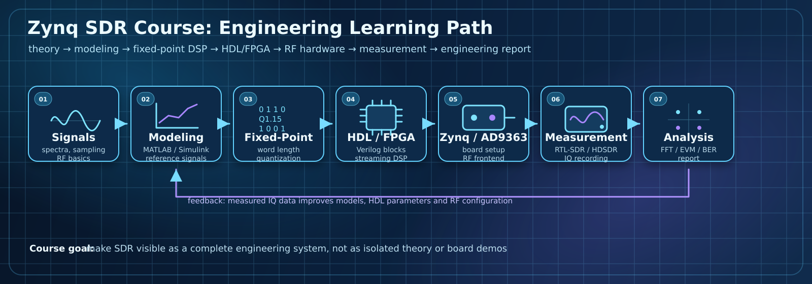

# Zynq SDR Course

[](https://lay007.github.io/zynq-sdr-course/)
[](https://github.com/Lay007/zynq-sdr-course/wiki)
[](https://github.com/Lay007/zynq-sdr-course/discussions)
[](https://github.com/Lay007/zynq-sdr-course/actions/workflows/full_course_smoke.yml)
[](https://github.com/Lay007/zynq-sdr-course/actions/workflows/block5_hdl.yml)
[](https://github.com/Lay007/zynq-sdr-course/actions/workflows/block8_sync.yml)
[](https://github.com/Lay007/zynq-sdr-course/actions/workflows/block9_recording_analysis.yml)
[](LICENSE)
[](https://ru.linkedin.com/in/alexander-lyubko-dsp)

> A practical engineering course on Software-Defined Radio with DSP, fixed-point design, FPGA/HDL, Zynq, RF measurements and reproducible reporting.

**Russian version:** [README_RU.md](README_RU.md)



---

## Start here

| If you want to… | Open |
| --- | --- |
| Follow the course from the beginning | [Course website](https://lay007.github.io/zynq-sdr-course/), [student path](docs/student-path.md) |
| Set up tools or choose a hardware route | [Learning routes](LAB_TRACK_en.md), [Getting Started Wiki](https://github.com/Lay007/zynq-sdr-course/wiki/Getting-Started) |
| Understand the signal path from DSP model to FPGA and RF | [Architecture Wiki](https://github.com/Lay007/zynq-sdr-course/wiki/Architecture), [DSP to FPGA](https://github.com/Lay007/zynq-sdr-course/wiki/DSP-to-FPGA) |
| Bring up Zynq/AD936x or diagnose a failure | [Hardware Wiki](https://github.com/Lay007/zynq-sdr-course/wiki/Hardware), [Troubleshooting](https://github.com/Lay007/zynq-sdr-course/wiki/Troubleshooting) |
| Review evidence instead of just reading claims | [Reviewer path](docs/reviewer-path.md), [hardware evidence index](docs/hardware-evidence-index.md) |
| Teach the course or add a lab | [Instructor guide](docs/instructor-guide.md), [Contributing](CONTRIBUTING.md) |
| Ask a question or contribute | [FAQ](https://github.com/Lay007/zynq-sdr-course/wiki/FAQ), [Support](SUPPORT.md), [Contributing](CONTRIBUTING.md) |

**Evidence convention:** model/synthetic, RTL-tested, FPGA-tested and RF-measured results are different levels of validation. Check the linked report and its limitations before relying on a metric.

---

## Overview

`zynq-sdr-course` is a bilingual SDR engineering course built around a complete model-to-measurement workflow:

```text
theory -> DSP model -> fixed-point design -> HDL/FPGA -> Zynq/AD9363 -> RF path -> IQ recording -> offline analysis -> engineering report
```

The repository is designed not only as a set of learning notes, but as a reproducible engineering workspace. It combines documentation, executable labs, HDL smoke checks, IQ metadata discipline, measurement templates and final-project structure.

---

## What you will learn

| Layer | Engineering outcome |
|---|---|
| Signal theory | Sampling, bandwidth, aliasing, IQ representation and modulation basics |
| DSP modeling | FFT, FIR, windows, digital mixing, decimation and reference plots |
| Fixed-point design | Scaling, word length, saturation, quantization error and implementation risk |
| HDL / FPGA | Streaming DSP blocks, Verilog testbenches, latency and RTL/model comparison |
| Zynq + AD9363 | RF frontend configuration, gain planning and board-level experiment discipline |
| TX/RX chains | DUC/DDC, loopback metrics, packet detection and measurement flow |
| Synchronization | CFO, phase/timing recovery, EVM, BER and OFDM mini-link analysis |
| IQ data engineering | CI16/CU8/CF32 readers, metadata, dataset manifests and replay checks |
| Measurement reporting | SNR, EVM, BER, uncertainty notes, limitations and final engineering conclusions |

---

## Hardware baseline

The hardware-oriented part of the course is built around:

- **Xilinx Zynq-7020** class boards;
- **AD9363 / AD9361 RF frontends**, subject to the exact board and image;
- **RTL-SDR** as an independent observation receiver;
- controlled RF paths with attenuation, metadata and safety notes.

The course can still be studied in simulation-only mode, because many labs have synthetic data, reproducible scripts and CI-backed checks.

### Companion repositories

- For C++ DSP kernels, numerical tests, CMake packaging, and reproducible benchmarks, see
  **[cpp-dsp-showcase](https://github.com/Lay007/cpp-dsp-showcase)**.
- For the next step beyond the Block 8 CSS/LoRa-like labs, see
  **[zynq-lora-phy](https://github.com/Lay007/zynq-lora-phy)**:
  a dedicated Zynq SDR project for LoRa PHY implementation, synchronization,
  hardware PER measurements, and positioning research.
- Published bitstreams, boot sets and board backups live in the private
  `zynq-sdr-course-artifacts` repository. The source repository keeps manifests,
  measurements and rebuild instructions, but not large or board-specific binaries.

---

## Repository structure

| Path | Purpose |
|---|---|
| `docs/` | MkDocs website pages, course maps, reports, guides and generated assets |
| `blocks/` | Course block source materials and lab implementations |
| `hardware/` | Curated local board bundles and bring-up starting points |
| `tools/` | Build, smoke-test and reproducibility scripts |
| `templates/` | Lab report, IQ metadata, RF safety and final-project templates |
| `datasets/` | Dataset manifests and lightweight dataset descriptors |
| `reports/` | FPGA reports, measurement examples and reviewer evidence maps |
| `experiments/` | Machine-checkable experiment manifests |

---

## Requirements

| What | Needed for | Notes |
|---|---|---|
| Python 3.12 or newer | everything | CI runs Python 3.12 on Ubuntu; the course is also used on Windows 11 with Python 3.14. Pinned packages in `requirements.txt`. |
| Git LFS | the recorded IQ captures and datasets | `git lfs install`, then `git lfs pull`. Without it the captures are only small text pointer files. |
| Icarus Verilog 12 (`iverilog`, `vvp`) | every HDL testbench (`tasks.py hdl`, `tools/run_ofdm_rtl.py`) | Not needed for the Python labs. |
| Vivado 2021.1 | out-of-context reports and board images (Blocks 5, 8, 11) | Not needed for simulation. The board images are built by `hardware/7020_ad936x_sdr/rebuild_vendor_xpr_snapshot_course_overlay.tcl`. |
| MATLAB / Simulink | the optional `.slx` models of Block 4 | Python covers the baseline route; running `.slx` models requires MATLAB/Simulink and the toolboxes listed by the lab. |
| An RTL-SDR, then a Zynq-7020 + AD9363/AD9361 board | the hardware routes | Start without them: [learning routes](LAB_TRACK_en.md) A (laptop only) to D (bench instruments). |

## Quick start

```bash
git clone https://github.com/Lay007/zynq-sdr-course.git
cd zynq-sdr-course
python tools/tasks.py install
python tools/tasks.py docs
python tools/tasks.py labs
```

Success means that the strict MkDocs build completes and all 20 representative labs report `PASS`. The final lines name the summary files in `docs/assets/`. Runtime depends on the workstation. Strict mode checks configured documentation warnings; it does not check external URL availability.

Run the broader local smoke check:

```bash
python tools/tasks.py smoke
```

Run a CI-like local preflight before pushing larger changes:

```bash
python tools/tasks.py install-dev
python tools/run_local_ci.py
```

Useful commands:

For an isolated environment and PowerShell commands, see the [reproducibility guide](docs/reproducibility-guide.md). `--quick` still includes long HDL simulations; use `--software-only` for checks without Icarus.

| Command | Purpose |
|---|---|
| `python tools/tasks.py install` | Install Python dependencies |
| `python tools/tasks.py install-dev` | Install runtime plus lint/test dependencies |
| `python tools/tasks.py docs` | Build the MkDocs site in strict mode |
| `python tools/tasks.py serve` | Start a local documentation preview |
| `python tools/tasks.py labs` | Run representative executable Python labs |
| `python tools/tasks.py hdl` | Run the Block 5 and Block 8 CSS Verilog regressions |
| `python tools/tasks.py smoke` | Run docs + labs + HDL checks |
| `python tools/run_local_ci.py` | Run lint + pytest + docs + labs + canonical HDL smoke |
| `python tools/run_local_ci.py --quick` | Run lint + pytest + canonical HDL smoke |
| `python tools/run_local_ci.py --software-only` | Run lint + lab ID registry + pytest without Icarus |
| `python tools/run_local_ci.py --hdl-only` | Run Block 5, CSS and OFDM simulations; requires Icarus |
| `python tools/check_lab_id_registry.py` | Validate canonical ownership of late Block 11 lab IDs |
| `python tools/check_dataset_manifests.py` | Validate dataset manifests and Git LFS pointer checksums |
| `python tools/tasks.py clean` | Remove generated local artifacts |

Curated local board starting point:

- [`hardware/7020_ad936x_sdr/README.md`](hardware/7020_ad936x_sdr/README.md): imported Zynq-7020 + AD936x board bundle for bring-up work.

The OFDM testbenches are not part of `tasks.py hdl`: run `python tools/run_ofdm_rtl.py` (it ends with `OFDM RTL (...): N testbenches and M parameter variant(s) passed`).

## Common problems

| Symptom | Cause and fix |
|---|---|
| `iverilog` or `vvp` not found | Install Icarus Verilog and put it on `PATH`; only the HDL checks need it. |
| A lab that reads a recorded capture fails on the file format, or the file is a few hundred bytes | It is a Git LFS pointer, not the capture: `git lfs install && git lfs pull`. |
| `mkdocs build --strict` stops with a warning | A page links to a file or anchor that does not exist; the warning names both. |
| Vivado fails with `couldn't read file ... No error` or a crash in synthesis | Inspect the first error and memory use. The course bench encountered memory exhaustion with parallel builds; retry one build with `-jobs 1` and retain the log. |
| A Russian page looks garbled in a Windows console | The files are UTF-8; read them with `Get-Content -Encoding utf8` or an editor. |
| Board problems (no TX, a carrier between bursts, an AD9361 that stops after a runtime bitstream load) | See the [hardware evidence index](docs/hardware-evidence-index.md) and the Block 11 labs; each problem met on the bench has its own page. |

---

## Recommended learning path

1. **Intro to SDR**: tools, signals and first reception concepts.
2. **Signals and sampling**: spectrum, aliasing, complex baseband and IQ.
3. **DSP basics**: FFT, FIR, windows, mixing and decimation.
4. **Fixed-point workflow**: numeric formats, scaling and quantization.
5. **FPGA / HDL flow**: streaming interfaces, Verilog and testbenches.
6. **RF frontend**: frequency plans, gain staging and AD9363 settings.
7. **TX/RX chains**: DUC, DDC, loopback and packet-level metrics.
8. **Synchronization**: CFO, phase, timing, EVM and BER.
9. **IQ recording and analysis**: metadata, formats, replay and quality checks.
10. **Electronics and KiCad**: attenuators, filters and RF safety.
11. **Integrated SDR project**: model, implementation, capture and report.
12. **Final projects**: a project of your own, from proposal to measured report.

Which labs need which hardware, and in what order: [learning routes](LAB_TRACK_en.md).

---

## Community and roadmap

- **[Discussions](https://github.com/Lay007/zynq-sdr-course/discussions):** ask questions about labs, DSP, fixed-point, HDL and SDR hardware; share experiments or propose new ideas.
- **[Issues](https://github.com/Lay007/zynq-sdr-course/issues):** report reproducible defects and track concrete engineering work.
- **[Project Roadmap](https://github.com/users/Lay007/projects/1):** follow the development backlog, progress and verification stages. The board uses the existing GitHub Issues; see [#77](https://github.com/Lay007/zynq-sdr-course/issues/77) for community setup.
- **[Support](SUPPORT.md):** choose the right place to ask a question or report a problem.

The [Wiki](https://github.com/Lay007/zynq-sdr-course/wiki) is a quick reference; lab instructions and validated measurements remain on the [course website](https://lay007.github.io/zynq-sdr-course/).

Maintainers edit [tracked Wiki sources](wiki/README.md) and publish them separately after review. See the [community maintenance checklist](COMMUNITY_PLAYBOOK.md) for the current GitHub setup.

---

## Key documentation pages

| Page | Why open it |
|---|---|
| [Course demo dashboard](docs/demo-dashboard.md) | Fast visual overview of executable course artifacts |
| [Visual course map](docs/course-map.md) | Complete route from theory to final project |
| [Student path](docs/student-path.md) | Shortest learner route through the repository |
| [Reviewer path](docs/reviewer-path.md) | Evidence-oriented review path for quick evaluation |
| [Reviewer acceptance checklist](docs/reviewer-checklist.md) | Pass/fail-style checklist for reproducibility, DSP, HDL, RF and final-project evidence |
| [Flagship reviewer report](reports/flagship_reviewer_report.md) | One-page portfolio-style evidence story with limitations and reproduction commands |
| [Course evidence map](reports/course-evidence-map.md) | Compact map of proven artifacts, gaps and next evidence actions |
| [Instructor guide](docs/instructor-guide.md) | How to use the repository as a teaching workspace |
| [Model → FPGA → RF → Measurement](docs/model-to-measurement.md) | Core engineering workflow of the course |
| [Course status](docs/status.md) | Readiness matrix, gaps and next improvements |
| [Reproducibility guide](docs/reproducibility-guide.md) | How to rebuild results and generated artifacts |
| [Real data policy](docs/real-data-policy.md) | How to handle IQ data without repository bloat |
| [Learning routes](LAB_TRACK_en.md) | Routes A-D: laptop only, + RTL-SDR, + Zynq board, + bench instruments |
| [Writing a lab](docs/contributing-labs.md) | Page structure, checks and conventions for new labs |

---

## Evidence and limitations

Evidence belongs to a particular experiment and image. These reports document earlier measurements; local Python/RTL checks do not repeat them.

| Component | Available evidence | Limit |
| --- | --- | --- |
| DSP and fixed-point | Deterministic models and [regressions](docs/ci-matrix.md) | Model checks do not establish FPGA or RF behavior |
| Two-board QPSK | [Lab 11.4 final report](blocks/block_11_integrated_sdr_project/lab_11_4_final_measurement_report.md): 915 MHz, zero whole-burst rotations, payload BER about 4×10⁻⁴ | Configuration-specific result; residual DC-blocker losses remain in [#66](https://github.com/Lay007/zynq-sdr-course/issues/66) |
| Mailbox and chat | [Link-layer measurements](reports/hardware/two-board-link-layer-20261017.md), Labs 11.49-11.52 | The new RX_STOP implementation in [#71](https://github.com/Lay007/zynq-sdr-course/issues/71) still needs board validation |
| OFDM | [AXI DMA fabric loopback](reports/hardware/ofdm-dma-fabric-loopback-20261014.md): 0 errors in 3,072,000 bits | Radio stage simulated and built; RF validation in [#48](https://github.com/Lay007/zynq-sdr-course/issues/48) remains open |
| IQ datasets | [Manifests](docs/iq-dataset-manifest.md) and [data policy](docs/real-data-policy.md) distinguish measured captures from synthetic QPSK replay | Some measured raw captures and board images are not publicly available |

Remaining work includes OFDM RF validation, board measurements of RX_STOP, RF-path calibration and repeat-build timing robustness. See [course status](docs/status.md), the [hardware evidence index](docs/hardware-evidence-index.md) and the [2026-10-28 engineering review](reports/repository-review-2026-10-28.md).

---

## Author

Alexander Lyubko. Questions about the course, and R&D work on SDR, DSP, fixed-point design,
MATLAB/Simulink-to-RTL and Zynq/AD936x integration: [engineering portfolio](https://lay007.github.io/),
[GitHub](https://github.com/Lay007), [LinkedIn](https://ru.linkedin.com/in/alexander-lyubko-dsp).

---

## License

MIT License. See [LICENSE](LICENSE).
