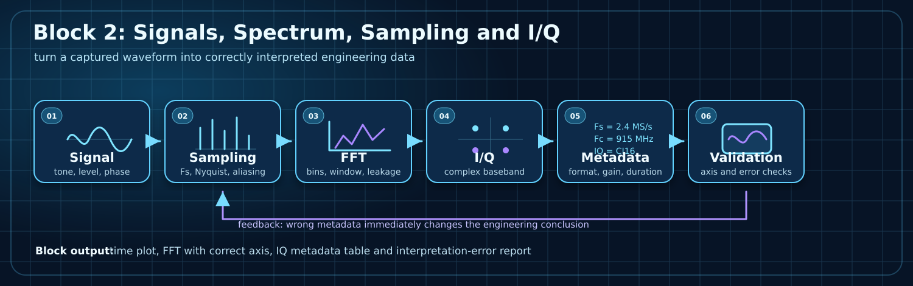

# Block 2: Signals, Spectrum, Sampling and I/Q

Russian version: [README_ru.md](README_ru.md). Full English overview: [README_en.md](README_en.md).

`block_02_signals_and_sampling` is the signal-interpretation block of the course.
It teaches how to turn a waveform or IQ file into correctly interpreted engineering data.



## Main idea

A spectrum can look correct and still lead to a wrong conclusion if `Fs`, `Fc`, IQ order, file format, gain or frequency axis are interpreted incorrectly.

## Learning outputs

| Output | Engineering value |
|---|---|
| Time-domain plot | check amplitude, clipping, DC offset and visible artifacts |
| FFT with correct axis | connect FFT bins to physical/baseband frequency |
| IQ metadata table | make recordings reproducible |
| Aliasing/leakage notes | prevent wrong spectral interpretation |
| Short lab report | document assumptions and interpretation errors |

## Lab matrix

| Lab | Topic | Main artifact | Diagnostic value |
|---|---|---|---|
| [Lab 2.1](lab_2_1_sampling_axis_and_interpretation.md) | Sampling axis and interpretation | time preview, FFT-axis comparison, metrics JSON | detect wrong `Fs` assumptions |
| [Lab 2.2](lab_2_2_aliasing_sweep.md) | Aliasing sweep | alias map, example spectra, metrics JSON | predict spectral folding above Nyquist |
| [Lab 2.3](lab_2_3_iq_interpretation_and_mirroring.md) | I/Q interpretation and mirroring | complex/swapped/real spectrum comparison | catch I/Q-order and mirrored-spectrum mistakes |

## Practical path

1. Observe a known signal.
2. Define sampling parameters.
3. Build FFT and frequency axis.
4. Interpret I/Q baseband representation.
5. Document metadata.
6. Detect deliberate interpretation mistakes.

Run the representative executable subset from the repository root:

```bash
python tools/run_all_labs.py
```

## Connection to next block

Block 2 teaches how to read a signal correctly. Block 3 uses this foundation to modify the signal: windowing, filtering, digital mixing, decimation and quality metrics.

