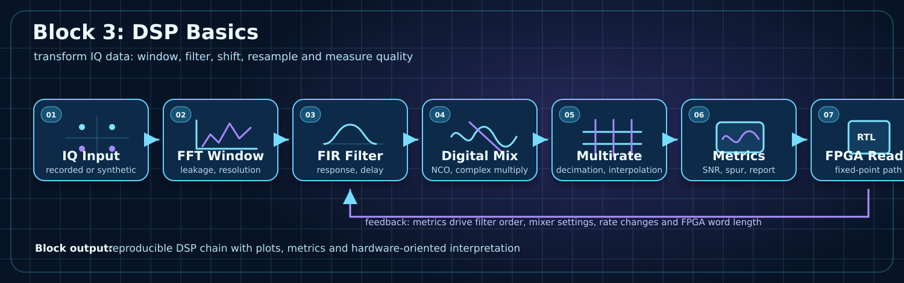

# Block 3: DSP Basics

Russian version: [README_ru.md](README_ru.md). Full English overview: [README_en.md](README_en.md).

`block_03_dsp_basics` is the active signal-processing block of the course.
It moves from interpreting IQ data to transforming it with FFT windows, filters, digital mixing, multirate operations and metrics.



## Main idea

A DSP chain is engineering-ready only when every operation is measurable, reproducible and explainable in terms of spectrum, delay, noise, distortion and future FPGA implementation cost.

## Lab matrix

| Lab | Topic | Main artifact | FPGA/RF connection |
|---|---|---|---|
| [Lab 3.1](lab_3_1_fft_windows_and_leakage.md) | FFT windows and leakage | spectrum comparison | measurement discipline |
| [Lab 3.2](lab_3_2_fir_low_pass_filter.md) | FIR low-pass filtering | response + filtered IQ | future FIR RTL block |
| [Lab 3.3](lab_3_3_digital_mixing.md) | Digital mixing | spectrum before/after shift | NCO + complex multiplier |
| [Lab 3.4](lab_3_4_decimation.md) | Decimation | anti-aliasing validation | rate-change block for FPGA |

## Common lab structure

Each lab now follows the same engineering format:

```text
Goal
Theory
Experiment
Python implementation
MATLAB implementation
C++ bridge
FPGA / Verilog bridge
Expected plots
Report checklist
Engineering conclusion template
```

## Engineering outputs

- windowed FFT plots;
- FIR response and filtered spectrum;
- digital mixing before/after plots;
- decimation with anti-aliasing evidence;
- SNR/noise-floor/spur observations;
- short reproducible report for each lab.

## Connection to next blocks

Block 3 prepares the DSP primitives that later become fixed-point and HDL blocks: FIR, mixer/NCO, decimator, measurement metrics and reproducible plots.

