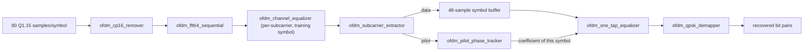
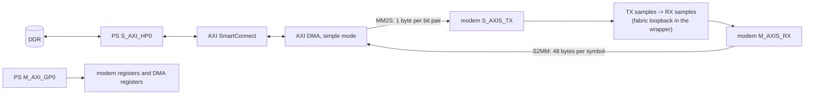
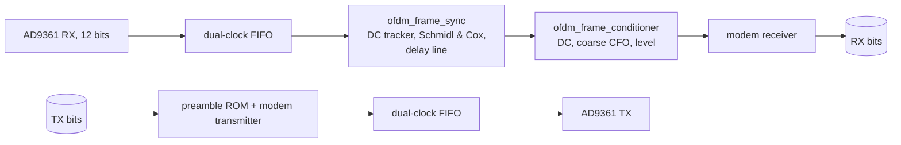

# Lab 8.14 — OFDM RTL: mapper to equalized loopback

## Goal

Take the [Lab 8.5](/zynq-sdr-course/en/labs/lab-8-5-ofdm-mini-link/) OFDM mini-link from a floating-point Python model to a synthesizable, self-checked fixed-point datapath: QPSK mapper, subcarrier allocator/extractor, a streaming radix-2 64-point IFFT/FFT, cyclic-prefix insertion/removal and a one-tap equalizer, each with its own Icarus Verilog testbench, composed into a full TX-to-RX digital loopback and a channel-equalized loopback.

This lab is the software/RTL half of issue #48. Read the [evidence boundary](#what-this-lab-does-and-does-not-prove) before treating any result here as a hardware measurement: it is not one.

## Why a second, RTL-level model of the same chain

[Lab 8.5](/zynq-sdr-course/en/labs/lab-8-5-ofdm-mini-link/) already proves the OFDM algorithm works in floating point. That is not the same claim as "this runs on the FPGA fabric." Every stage here exists twice, on purpose:

- once as a bit-exact Q1.15 fixed-point Python model (`tools/ofdm_ifft_fixed.py`, `tools/ofdm_fft_fixed.py`, `tools/ofdm_equalizer_fixed.py`) that tracks every rounding and saturation decision explicitly;
- once as synthesizable Verilog that is checked against the *same* committed vectors as that fixed-point model, not just against its own testbench's expectations.

That second copy is what makes "the RTL is correct" a falsifiable claim instead of an assumption. The `verification/vectors/block08_ofdm_*.mem` files are the shared ground truth: `tests/test_ofdm_ifft_fixed.py`, `tests/test_ofdm_fft_fixed.py` and `tests/test_ofdm_tx_fixed.py` check the Python model against them, and `tb_ofdm_ifft64_sequential.sv`/`tb_ofdm_fft64_sequential.sv` check the RTL against the same files, so a mismatch between Python and RTL cannot hide.

## TX chain


| Block | Role | Fixed-point / timing contract |
|---|---|---|
| `ofdm_qpsk_mapper.v` | 2 bits -> one Q1.15 QPSK symbol, matching Lab 8.5's `qpsk_from_bits` sign convention | magnitude `round(32767/sqrt(2)) = 23170`; 1-cycle latency |
| `ofdm_subcarrier_allocator.v` | Places 48 data symbols into a natural-order 64-bin IFFT frame and inserts the four pilot values (`pilot_ref = [+1,+1,+1,-1]`) at `k = -21,-7,+7,+21`, exactly like Lab 8.5's frequency-domain layout | collects 48 symbols, then emits bins 0..63; no new frame accepted mid-emission |
| `ofdm_ifft64_sequential.v` | Streaming radix-2 DIT IFFT, one `ofdm_ifft_butterfly` instance reused for all 6 stages x 32 butterflies | each butterfly divides by 2 -> normalized `1/64` scale; `total_saturation_count` accumulates clipped final components across all 192 butterflies |
| `ofdm_cp16_inserter.v` | Prepends samples `[48..63]` as the cyclic prefix | emits 80 samples/symbol (`out_is_cp` high for indices 0..15); `frame_error` if the input symbol was short |

`ofdm_tx_mapper_ifft_path.v` composes mapper -> allocator -> IFFT; `ofdm_tx_cp16_path.v` adds the CP stage and is the complete TX baseline used by the loopback tests below.

## RX chain



| Block | Role | Fixed-point / timing contract |
|---|---|---|
| `ofdm_cp16_remover.v` | Drops the 16-sample prefix, forwards samples 16..79 unchanged | fully backpressured on the 64 useful samples |
| `ofdm_fft64_sequential.v` | Scaled forward FFT, built by reusing the IFFT core via `FFT(x)/N = conj(IFFT(conj(x)))` | rare Q1.15 endpoint clips from conjugating `-32768` are counted, not hidden |
| `ofdm_subcarrier_extractor.v` | Splits the 64 bins into 48 data, 4 pilot and 12 null/guard carriers -- the exact inverse of the allocator's layout | data and pilot are independently backpressured sinks; a stalled pilot sink cannot stall data (or vice versa) |
| `ofdm_pilot_phase_tracker.v` | Turns each symbol's four pilots into a Q2.14 phase-correction coefficient (vectoring + rotation CORDIC) | sign-only pilot references, 14 CORDIC iterations, `pilot_ready` low for 31 cycles per symbol; bit-exact with `tools/ofdm_pilot_phase_tracker_fixed.py` |
| `ofdm_channel_equalizer.v` | Estimates `H[k]` on every used carrier from a training symbol and removes its phase from later symbols | `G = Y*conj(sign X)` (additions only); `NORMALIZE = 0`: `Z = Y*conj(G) >> 4`, amplitude not normalized, 3-clock pipeline; `NORMALIZE = 1`: zero-forcing `2^14 * Y/G` with a CORDIC `1/abs(G)^2` per bin, 7-clock pipeline; bit-exact with `tools/ofdm_channel_equalizer_fixed.py` |
| `ofdm_pilot_phase_corrector.v` | Wires the tracker to the equalizer: buffers one symbol's data and applies the coefficient of that same symbol | 48-entry buffer; `data_ready` and `pilot_ready` stay low while the buffer drains, so latency is one symbol plus the tracker's 31 clocks; tracker and equalizer arithmetic unchanged |
| `ofdm_one_tap_equalizer.v` | Multiplies each data symbol by an externally supplied Q2.14 correction coefficient | Q1.15 x Q2.14 -> Q3.29, rounded to Q15 (nearest, half-LSB away from zero), then saturated; `saturation_count` is cumulative from reset |
| `ofdm_cfo_corrector.v` | Time-domain CFO correction before CP removal (stage 2e) | CP correlation accumulated over symbols, 20-step vectoring CORDIC, 32-bit NCO, pipelined 16-step rotation CORDIC; bit-exact with `tools/ofdm_cfo_corrector_fixed.py` |
| `ofdm_qam16_demapper.v` | Gray 16-QAM slicer (stage 2e) | needs the zero-forcing equalizer; threshold `2^14/3 = 5461` |
| `ofdm_qpsk_demapper.v` | Hard-decision inverse of the mapper | transparent ready/valid, zero maps to bit `0` exactly like the Python reference |

## Fixed-point contract, in one place

Every sample in this chain is signed Q1.15 (`±1` represented as `±32767`/`-32768`, the usual asymmetric two's-complement endpoint). The one deliberate exception is the equalizer's correction coefficient, Q2.14, so a correction gain up to almost 2.0 can be represented without silently rescaling the signal path. Every arithmetic stage that can lose precision or range -- IFFT/FFT butterflies, the equalizer's complex multiply -- rounds explicitly (nearest, half-LSB away from zero) and saturates explicitly, and every saturation is *counted*, not just clamped: `total_saturation_count` on the TX/IFFT side, `total_saturation_count` + `conjugation_saturation_count` on the FFT side, `saturation_count` on the equalizer. That satisfies issue #48's "explicit scaling, saturation and overflow counters" requirement directly, and it is what makes the acceptance criterion below checkable rather than assumed:

> "No undocumented saturation at the selected back-off."

Every loopback test below asserts every one of these counters is exactly zero, and would fail loudly if any stage clipped silently.

## Streaming contract

Every block uses one clock, synchronous active-low reset, and a single-register ready/valid handshake: a producer must hold `valid` and its data stable until `ready` is also high, and a consumer's `ready` can depend combinationally on its own occupancy but not create a combinational loop back through `valid`. This is deliberately the same discipline the QPSK modem chain elsewhere in this course already uses. Inside the chain the signal names stay `valid`/`ready`/`re`/`im`/`index`/`last`; `ofdm_axi_modem.v` is the AXI packaging around the whole TX and RX chains:

| Interface | Format |
|---|---|
| `s_axis_tx` | `tdata[1:0]` = one QPSK bit pair (`tdata[3:0]`, four bits, with `MODULATION = 1`); 48 per symbol (`tlast` is not used, framing is by count) |
| `m_axis_tx` | `tdata = {Q, I}`, Q1.15; 80 samples per symbol, CP first, `tlast` on the 80th |
| `s_axis_rx` | `tdata = {Q, I}`, Q1.15; 80 samples per symbol, `tlast` on the 80th (a misplaced `tlast` sets the RX frame-error flag) |
| `m_axis_rx` | QPSK: `tdata[7:0] = {data_index, bits}`; 16-QAM: `tdata[15:0] = {2'b00, data_index, 4'b0000, bits}`, so the index stays byte-aligned. 48 per symbol in FFT bin order (data indices 24..47, then 0..23), `tlast` on the 48th |
| `s_axi` (AXI4-Lite) | `0x00` ID `"OFDM"`, `0x04` version (`0x00030100`), `0x08` control (bit 0 datapath reset, bit 1 retrain, bit 8 clear sticky errors), `0x0C` status (bit 6: channel trained), `0x10`-`0x18` TX/FFT/EQ saturation counters, `0x1C`/`0x20` TX/RX symbol counters, `0x24` pilot phase, `0x28` correction coefficient, `0x2C` channel-equalizer saturations, `0x30` trainings completed (one per `CE_TRAIN_SYMBOLS` training symbols), `0x34` CFO estimate `theta = -2^24 * 64 * CFO` (CFO in cycles per sample, sign-extended 24-bit), `0x38` build configuration (bit 0 `MODULATION`, 1 `CHANNEL_EQ`, 2 `NORMALIZE`, 3 `CFO_CORR`, 4 `BRAM_MEMORY`, 8:5 `CE_TRAIN_SYMBOLS`) |

The RX chain includes the time-domain CFO corrector of stage 2e (`CFO_CORR = 1`) and the
per-subcarrier `ofdm_channel_equalizer.v` of stage 2d (`CHANNEL_EQ = 1`, zero-forcing
`NORMALIZE = 1` by default). `MODULATION = 1` builds the 16-QAM variant; it requires the zero-forcing
equalizer, because only that puts the inner and outer levels on one grid. The first symbol received
after reset, and after writing `CONTROL[1]`, must be the training symbol: the host sends the
equalizer's `train_bits()` pattern as 48 bit pairs on `s_axis_tx` (16-QAM: the same signs on the
outer points, `{b1, 0, b0, 0}`). Retraining also restarts the CFO estimate. That symbol produces no `m_axis_rx` output, and `STATUS[6]`
rises when the coefficients are ready. `tb_ofdm_axi_modem.sv` sends the training symbol and three data
symbols from `s_axis_tx` through a rotated channel into `s_axis_rx` with random stalls on the link and
on `m_axis_rx_tready`, then resets the datapath and retrains through `CONTROL[1]`, each time followed by
one more data symbol. It checks BER=0, the register map, that the pilot phase register reads about 0
once the channel is equalized, that `CFO_THETA` reads the applied offset within 1 %, and the sticky RX
frame error. With `CFO_PPM` the bench also turns the channel phase by the offset on every sample;
CI runs QPSK at 120 and -150 degrees and 16-QAM at 120 degrees under 5000 ppm:

```text
PASS: ofdm_axi_modem (MODULATION=0, NORMALIZE=1, CFO 0 ppm) 120-degree channel recovered 480/480 bits in 5 symbols after 1 training symbol(s), BER=0; reset, retrain, registers and sticky errors checked
PASS: ofdm_axi_modem (MODULATION=1, NORMALIZE=1, CFO 5000 ppm) 120-degree channel recovered 960/960 bits in 5 symbols after 1 training symbol(s), BER=0; reset, retrain, registers and sticky errors checked
```

Stage 3 below puts it in a block design with the PS and an AXI DMA and runs it on a board; stage 4 connects it to the AD9361 through a frame search, in simulation and in a built image that has not run on a board yet.

## Pilots: what exists and what does not yet

The allocator/extractor pair does real pilot **insertion and extraction**: the allocator writes the four fixed pilot values into their bins on TX, and the extractor produces a *separate* pilot stream on RX (`pilot_re`/`pilot_im`/`pilot_slot`/`pilot_ref_re`) alongside the data stream, exactly mirroring Lab 8.5's `pilot_k`/`pilot_ref`.

`ofdm_pilot_phase_tracker.v` consumes that pilot stream. Per OFDM symbol it forms `P = sum(sign(pilot_ref) * pilot)` (the references are +-1, so no multipliers), finds `angle(P)` with a 14-iteration vectoring CORDIC, and turns it into the correction coefficient `16384 * exp(-j * angle(P))` in Q2.14 with a rotation CORDIC, which is the input format of `ofdm_one_tap_equalizer`. It is the fixed-point form of Lab 8.5's `pilot_phase = angle(vdot(pilot_ref, y_eq[pilots]))`. `pilot_ready` drops for the 31 cycles of computation, and an all-zero pilot sum returns the identity coefficient with a `zero_energy` flag.

It is verified like the rest of the chain: `tools/ofdm_pilot_phase_tracker_fixed.py` is the bit-exact model, `tools/generate_ofdm_pilot_tracker_vectors.py` writes 49 test symbols (every 15 degrees, the +-90 and +-180 degree edges, amplitudes 300 to 32000, zero energy, and noisy symbols whose four pilots disagree), and `tb_ofdm_pilot_phase_tracker.sv` requires a bit-exact match while holding `pilot_valid` high through the busy cycles:

```bash
python -m pytest tests/test_ofdm_pilot_phase_tracker_fixed.py
python -m tools.generate_ofdm_pilot_tracker_vectors   # regenerate the committed vectors
python tools/run_ofdm_rtl.py                          # all OFDM benches, including the tracker
```

```text
PASS: ofdm_pilot_phase_tracker matched the fixed-point model on 49 symbols (backpressure cycles 1490)
```

Against the ideal `exp(-j * theta)`, the coefficient is within 7 LSB of 16384 (0.04 %) and the phase within 3 units of pi/2^15 (about 3e-4 rad) at every whole degree.

The coefficient belongs to the symbol whose pilots produced it, but that symbol's data has already streamed past by the time the last pilot (bin 57) arrives. `ofdm_pilot_phase_corrector.v` therefore holds the symbol's data in a 48-entry buffer and releases it through the equalizer once the coefficient is ready: same-symbol correction, as in Lab 8.5, at the cost of one symbol of latency. Applying the coefficient to the *next* symbol instead would need no buffer but would track with a one-symbol lag. That correction is one common phase per symbol; a frequency-selective channel also needs the per-subcarrier estimate of stage 2d (`ofdm_channel_equalizer.v`).

## Verification stage 1: float model vs. fixed-point model vs. RTL

```bash
python -m pytest tests/test_ofdm_ifft_fixed.py tests/test_ofdm_fft_fixed.py \
  tests/test_ofdm_equalizer_fixed.py tests/test_ofdm_tx_fixed.py -q
```

These tests check the Q1.15 Python model's arithmetic (including saturation counts) against the committed `verification/vectors/block08_ofdm_*.mem` files. The RTL testbenches below check the *same* files, so a pass on both sides is a bit-exact three-way match: float intent -> fixed-point reference -> synthesizable RTL.

## Verification stage 2: self-checking RTL digital loopback

Every block has its own testbench; run the two end-to-end ones directly with Icarus Verilog:

```bash
RTL=blocks/block_08_modulation_and_synchronization/rtl
TB=blocks/block_08_modulation_and_synchronization/tb

iverilog -g2012 -o /tmp/tb_ofdm_loop.vvp \
  $RTL/ofdm_qpsk_mapper.v $RTL/ofdm_subcarrier_allocator.v \
  $RTL/ofdm_ifft_butterfly.v $RTL/ofdm_iq_bank_ram.v $RTL/ofdm_ifft64_sequential.v \
  $RTL/ofdm_tx_mapper_ifft_path.v $RTL/ofdm_cp16_inserter.v \
  $RTL/ofdm_tx_cp16_path.v $RTL/ofdm_cp16_remover.v \
  $RTL/ofdm_fft64_sequential.v $RTL/ofdm_subcarrier_extractor.v \
  $RTL/ofdm_qpsk_demapper.v \
  $TB/tb_ofdm_tx_rx_digital_loopback.sv
vvp /tmp/tb_ofdm_loop.vvp
```

The loopback through a +90-degree channel and the one-tap equalizer is a separate testbench:

```bash
iverilog -g2012 -o /tmp/tb_ofdm_eq_loop.vvp \
  $RTL/ofdm_qpsk_mapper.v $RTL/ofdm_subcarrier_allocator.v \
  $RTL/ofdm_ifft_butterfly.v $RTL/ofdm_iq_bank_ram.v $RTL/ofdm_ifft64_sequential.v \
  $RTL/ofdm_tx_mapper_ifft_path.v $RTL/ofdm_cp16_inserter.v \
  $RTL/ofdm_tx_cp16_path.v $RTL/ofdm_cp16_remover.v \
  $RTL/ofdm_fft64_sequential.v $RTL/ofdm_subcarrier_extractor.v \
  $RTL/ofdm_one_tap_equalizer.v $RTL/ofdm_qpsk_demapper.v \
  $TB/tb_ofdm_tx_rx_equalized_loopback.sv
vvp /tmp/tb_ofdm_eq_loop.vvp
```

Or run every OFDM testbench (23 of them) the way CI does; `--fabric` and `--baseline` select the
other IFFT/FFT builds:

```bash
python tools/run_ofdm_rtl.py
```

Measured results (reproduced by the commands above, on this repository's current RTL):

```text
PASS: OFDM TX->RX digital loopback recovered 96/96 bits with zero errors
PASS: OFDM +90deg channel -> -90deg equalizer recovered 96/96 bits, BER=0
```

The second result is not a trivial passthrough: the testbench applies a genuine +90-degree complex rotation to every transmitted sample in the time domain (`channel_re = -im, channel_im = re`), and the equalizer is given the exact inverse coefficient (`W = -j` in Q2.14) to undo it. Every saturation counter (`tx_saturation_count`, `fft_saturation_count`, `eq_saturation_count`) is asserted to be exactly zero in the same test, so "BER=0" is not concealing an overflow that happened to cancel out numerically.

## Verification stage 2b: pilot-corrected loopback

Here nobody gives the equalizer its coefficient. `ofdm_pilot_phase_corrector.v` buffers each symbol's 48 data samples, lets the tracker measure that symbol's four pilots, and then sends the buffered data through the equalizer with the coefficient of the same symbol. The testbench rotates the channel by `ANGLE_DEG` (120 degrees by default, far outside the +-45 degrees a QPSK slicer tolerates) and sends two symbols back to back:

```bash
for angle in 120 -150; do
  iverilog -g2012 -s tb_ofdm_tx_rx_pilot_corrected_loopback \
    -Ptb_ofdm_tx_rx_pilot_corrected_loopback.ANGLE_DEG=$angle \
    -o /tmp/tb_ofdm_pc_loop.vvp $RTL/ofdm_*.v $TB/tb_ofdm_tx_rx_pilot_corrected_loopback.sv
  vvp /tmp/tb_ofdm_pc_loop.vvp
done
```

```text
PASS: OFDM 120-degree channel -> pilot-corrected RX recovered 192/192 bits in 2 symbols, BER=0 (phase 21851, coeff=(-8201,-14183))
PASS: OFDM -150-degree channel -> pilot-corrected RX recovered 192/192 bits in 2 symbols, BER=0 (phase -27301, coeff=(-14186,8200))
```

The measured phase is the channel angle in units of pi/2^15 (120 degrees = 21845), and the coefficient is `16384 * exp(-j * phase)` in Q2.14. If the corrector is forced to apply the identity coefficient instead, the same test fails with 96/192 bit errors.

## Verification stage 2c: a carrier frequency offset

A static rotation is the easy case: every symbol needs the same coefficient. A carrier frequency
offset (CFO) makes the phase grow through every symbol and inside it. The same testbench takes
`CFO_PPM` (offset in 1e-6 cycles per sample) and `SYMBOLS`, and prints a `RESULT` line before
PASS/FAIL; `tools/run_ofdm_cfo_sweep.py` runs it for a list of offsets:

```bash
python tools/run_ofdm_cfo_sweep.py --angle-deg 30 --symbols 8
```

Measured with Icarus Verilog 12.0 (768 bits per point):

| CFO, ppm | CFO / subcarrier spacing | Phase step per symbol | Bit errors | RTL phase (last symbol) | Float-model phase |
|---:|---:|---:|---:|---:|---:|
| 0 | 0.000 | 0 deg | 0 | 5467 | 5461.3 |
| 1000 | 0.064 | 28.8 deg | 0 | -19767 | -19764.1 |
| 2000 | 0.128 | 57.6 deg | 0 | 20491 | 20487.2 |
| 4000 | 0.256 | 115.2 deg | 0 | -30221 | -30220.4 |
| 5000 | 0.320 | 144.0 deg | 0 | 9907 | 9904.7 |
| 6000 | 0.384 | 172.8 deg | 13 | -15547 | -15540.8 |
| 7000 | 0.448 | 201.6 deg | 71 | 24527 | 24514.3 |
| 8000 | 0.512 | 230.4 deg | 104 | -997 | -1006.0 |

Three things to read from it:

- **Same-symbol correction tracks large phase steps.** Up to 144 degrees per symbol the corrector
  still gives BER = 0, because each symbol is corrected with the phase measured on that symbol's
  own pilots. A receiver that applied the previous symbol's coefficient would be wrong by the whole
  step, and a QPSK slicer only tolerates 45 degrees.
- **What fails is the common-phase model, not the tracking.** Inside one symbol the phase still
  moves by `2*pi*CFO*64`, and the subcarriers stop being orthogonal: energy from every carrier
  leaks into its neighbours (inter-carrier interference, ICI). From about 0.38 of a subcarrier
  spacing the ICI alone flips bits. One coefficient per symbol cannot undo it; that needs CFO
  estimation and correction in the time domain, before the FFT.
- **The pilot estimate is biased, and the bias is not noise.** The tracker's phase differs from
  the mean channel phase of the symbol by an amount that grows with the CFO. The float model
  `tools/ofdm_cfo_pilot_bias.py` builds the same symbols and reproduces the RTL phase to within
  about 13 units (0.07 degrees); with the data carriers left empty the difference is zero. The
  bias is ICI from the data carriers leaking into the four pilot bins, and it depends on the data:

```bash
python tools/ofdm_cfo_pilot_bias.py --angle-deg 30 --symbols 8 --ppm 0 500 2000 4000
```

```text
   CFO ppm   mean phase   pilot estimate   bias (units, deg)   bias with pilots only
         0       5461.3           5461.3       0.0    0.00                   0.0
       500      25367.9          25624.8     256.9    1.41                  -0.0
      2000      19551.6          20487.2     935.6    5.14                  -0.0
      4000     -31894.2         -30220.4    1673.8    9.19                  -0.0
```

With a CFO the testbench therefore checks the BER and only reports the phase. CI runs the 2000 ppm,
8-symbol case.

## Verification stage 2d: a frequency-selective channel

One coefficient per symbol is enough while every subcarrier sees the same channel. A multipath
channel does not: its frequency response `H[k]` has a different gain and phase on every carrier.
`ofdm_channel_equalizer.v` sits between the FFT and the extractor and estimates `H[k]` from a
**training symbol**, the first symbol after reset, whose 48 data carriers carry a fixed known bit
pattern (`train_bits()`) and whose pilots are the usual ones:

- training: `G[k] = Y[k] * conj(sign(X[k]))`, only additions, because the reference signs are +-1;
- every later symbol: `Z[k] = Y[k] * conj(G[k]) >> 4`, rounded and saturated.

`Z[k]` is `|H[k]|^2` times the transmitted symbol: the channel phase is gone on every carrier, so
QPSK hard decisions are right **without a division**. The amplitude is not normalized (carriers in
a fade come out small), which is fine for QPSK and not for 16-QAM or for measuring EVM. Pilots are
equalized as well, so `ofdm_pilot_phase_corrector.v` downstream now measures only what changed
since the training symbol, such as a residual CFO. Lab 8.5 uses a different preamble (known values
on even carriers, interpolation in between, division by `H`); the training symbol here is closer
to the 802.11 long training field.

The block is bit-exact with `tools/ofdm_channel_equalizer_fixed.py` on 6 frames (identity, Lab 8.5
multipath, strong multipath with noise, a deep fade, equalizer saturation, bins near full scale):

```bash
python -m pytest tests/test_ofdm_channel_equalizer_fixed.py
python -m tools.generate_ofdm_channel_eq_vectors      # regenerate the committed vectors
```

```text
PASS: ofdm_channel_equalizer matched the fixed-point model on 6 frames, 768 equalized bins, saturation counts included
```

End to end, `tb_ofdm_tx_rx_multipath_loopback.sv` sends the training symbol and then data through
`h = 0.5 + 0.25 e^{j1.2} z^-3 + 0.15 e^{-j2.0} z^-7` (inside the cyclic prefix):

```bash
iverilog -g2012 -s tb_ofdm_tx_rx_multipath_loopback -o /tmp/tb_mp.vvp \
  $RTL/ofdm_*.v $TB/tb_ofdm_tx_rx_multipath_loopback.sv
vvp /tmp/tb_mp.vvp
```

```text
PASS: OFDM 3-path channel -> per-subcarrier equalizer recovered 384/384 data bits in 4 symbols after 1 training symbol, BER=0 (equalizer saturations 0)
```

With `-Ptb_ofdm_tx_rx_multipath_loopback.USE_CHANNEL_EQ=0` the per-subcarrier equalizer is bypassed
and only the common pilot phase is corrected: `FAIL BER nonzero: 24/384 bit errors`. Adding a CFO
(`CFO_PPM`, 8 data symbols) shows the two corrections working together: 0 errors at 500, 1000 and
2000 ppm, 2 of 768 bits at 3000 ppm, where the carriers in the deepest part of the fade meet the
inter-carrier interference of stage 2c.

### Zero-forcing: one amplitude grid for 16-QAM

QPSK only needs the signs, so `Z = Y*conj(G)` is enough; a 16-QAM slicer also needs every carrier
on the same amplitude grid. With `NORMALIZE = 1` the equalizer divides by `|G|^2` without a divider:
after the training symbol it stalls its input while a sequential linear-mode CORDIC computes
`1/|G[k]|^2` for every bin (shift `|G|^2` so its top bit is bit 35, then 17 iterations of
`y -/+= x >> i, z +/-= 2^(16-i)`), and data bins leave as `2^14 * Y/G`: about +-8192 per component on
every data carrier, about +-16384 on the pilots. The fixed-point model and the RTL agree bit for bit
in both modes (7 frames, one of which changes the channel after training to drive the saturation
path):

```text
PASS: ofdm_channel_equalizer (NORMALIZE=1) matched the fixed-point model on 7 frames, 896 equalized bins, saturation counts included
```

The multipath bench reports how far the decided components are from one grid, `rms(c - sign*A)/A`
with `A` their mean magnitude (`-Ptb_ofdm_tx_rx_multipath_loopback.NORMALIZE=1`, 8 data symbols):

| Equalizer | Bit errors | Mean amplitude `A` | Grid spread |
|---|---:|---:|---:|
| none (common pilot phase only) | 48/768 | 189 | 57.6 % |
| `NORMALIZE = 0` (phase only, `abs(H)^2` left in) | 0/768 | 5790 | 61.7 % |
| `NORMALIZE = 1` (zero-forcing) | 0/768 | 8192 | 0.4 % |
| `NORMALIZE = 1`, CFO 500 / 1000 / 2000 ppm | 0/768 | 8159 / 8113 / 7983 | 8.9 / 17.5 / 35.8 % |

Zero-forcing puts every carrier on one grid. A CFO then spreads it again: inside a symbol the phase
still moves by `2*pi*CFO*64`, which one coefficient per symbol cannot remove. QPSK does not care
(BER stays 0); a 16-QAM slicer would, so a QAM receiver needs CFO correction before the FFT.

## Verification stage 2e: 16-QAM and time-domain CFO correction

Two new blocks turn the chain into a 16-QAM receiver:

- `ofdm_qam16_mapper.v` / `ofdm_qam16_demapper.v`: Gray 16-QAM, four bits per carrier. On each axis
  the first bit is the sign and the second chooses the inner level `1/sqrt(10)` (10362) or the outer
  level `3/sqrt(10)` (31086). `ofdm_tx_cp16_path` selects the mapper with `MODULATION = 1`. The
  training symbol uses the outer points with the QPSK training signs, so the zero-forcing equalizer
  puts the outer level at `2^14/2 = 8192` and the inner one at a third of that: the slicer threshold
  halfway between them is `2^14/3 = 5461`, derived rather than tuned.
- `ofdm_cfo_corrector.v`, in front of the CP removal: it buffers each 80-sample symbol and forms the
  cyclic-prefix correlation `P = sum x[n] * conj(x[n+64])` over the 16 prefix samples (the prefix is a
  copy of the symbol's tail, so `angle(P) = -2*pi*64*CFO`), accumulated since reset. A 20-step
  vectoring CORDIC gives the angle, a 32-bit NCO advances by `angle/64` per sample, and a pipelined
  16-step rotation CORDIC rotates the same symbol back, including the training symbol. Bit-exact with
  `tools/ofdm_cfo_corrector_fixed.py` (6 streams, 1280 samples):

```bash
python -m pytest tests/test_ofdm_qam16_cfo_fixed.py
python -m tools.generate_ofdm_cfo_vectors      # regenerate the committed vectors
```

```text
PASS: ofdm_cfo_corrector matched the fixed-point model on 6 streams, 1280 samples; misplaced in_last flagged
PASS: 16-QAM mapper and slicer match the model (16 codes, thresholds)
```

`tb_ofdm_tx_rx_qam16_loopback.sv` runs 16-QAM through the whole chain (`CHANNEL = 1`: the Lab 8.5
multipath, 6 data symbols, 1152 bits per point) and reports the EVM against the ideal equalized
grid:

| CFO, ppm (spacing) | Without the CFO corrector | With the CFO corrector |
|---:|---:|---:|
| 0 | 0 errors, EVM 0.44 % | 0 errors, EVM 0.44 % |
| 500 (0.032) | 0 errors, EVM 8.4 % | 0 errors, EVM 0.44 % |
| 2000 (0.128) | 88 errors, EVM 34 % | 0 errors, EVM 0.45 % |
| 4000 (0.256) | 281 errors, EVM 74 % | 0 errors, EVM 0.54 % |
| 7000 (0.448) | 495 errors, EVM 162 % | 0 errors, EVM 0.50 % |
| 7700 (0.493) | | 0 errors, EVM 0.49 % |
| 8200 (0.525) | | 550 errors, EVM 146 % |

```bash
iverilog -g2012 -s tb_ofdm_tx_rx_qam16_loopback -Ptb_ofdm_tx_rx_qam16_loopback.CFO_PPM=6000 \
  -o /tmp/tb_qam16.vvp $RTL/ofdm_*.v $TB/tb_ofdm_tx_rx_qam16_loopback.sv
vvp /tmp/tb_qam16.vvp
```

What to read from it:

- **16-QAM needs the CFO removed before the FFT.** QPSK survived 0.32 subcarrier spacings with a
  per-symbol phase (stage 2c); 16-QAM already loses bits at 0.128, because the inter-carrier
  interference blurs the inner/outer decision long before it flips a sign.
- **The CP correlation has a range.** Its angle is unambiguous only while `64 * CFO` stays within
  half a turn, `abs(CFO) < 1/128` cycles per sample (7812.5 ppm, half a subcarrier spacing). At
  8200 ppm the angle wraps (`theta` changes sign) and the correction pushes the wrong way.
- **Multipath biases it slightly.** With no offset at all the corrector still reads a small one
  (up to about 26 ppm on the strong channel): the first samples of the prefix carry the previous
  symbol's echo, so the prefix is not an exact copy. The pilot tracker removes what is left; skipping
  the first prefix samples in the correlation would remove the bias at the cost of fewer samples.
- With the strong multipath (`CHANNEL = 2`) the EVM is 1.7 % at 0, 6000 and -4000 ppm: what remains
  is the equalizer, not the offset.

## Verification stage 2f: noise, and the price of one training symbol

`tb_ofdm_tx_rx_qam16_loopback.sv` can add white Gaussian noise after the channel
(`ESN0_DB10`, Es/N0 per used subcarrier in tenths of a dB; `MODULATION = 0` runs QPSK through the
same chain). The bench derives the noise level from the chain's scaling: a bin is `X/64`, so
time-domain noise of variance `2*sigma^2` per sample becomes `2*sigma^2/64` per bin and
`sigma = sqrt(abs(X)^2 / (128 * Es/N0))`. `tools/run_ofdm_ber_sweep.py` sweeps Es/N0 and prints the
measured BER beside the AWGN curve:

```bash
python tools/run_ofdm_ber_sweep.py --modulation qpsk --esn0 6 8 10 12 --seeds 4
python tools/run_ofdm_ber_sweep.py --modulation qam16 --esn0 14 16 18 20 22 --seeds 4
```

Flat channel, no CFO, 100 data symbols per run, four noise seeds per point (the full chain: CFO
corrector, FFT, zero-forcing equalizer trained on one noisy symbol, pilot phase, slicer):

| Modulation | Es/N0, dB | Bit errors / bits | BER | EVM | AWGN theory | Theory 3 dB later |
|---|---:|---:|---:|---:|---:|---:|
| QPSK | 6 | 3613 / 38400 | 9.4e-2 | 88.6 % | 2.3e-2 | 7.9e-2 |
| QPSK | 8 | 1793 / 38400 | 4.7e-2 | 68.6 % | 6.0e-3 | 3.8e-2 |
| QPSK | 10 | 669 / 38400 | 1.7e-2 | 52.7 % | 7.8e-4 | 1.3e-2 |
| QPSK | 12 | 152 / 38400 | 4.0e-3 | 40.6 % | 3.4e-5 | 2.4e-3 |
| 16-QAM | 14 | 2552 / 76800 | 3.3e-2 | 27.5 % | 9.4e-3 | 4.2e-2 |
| 16-QAM | 16 | 971 / 76800 | 1.3e-2 | 21.6 % | 1.8e-3 | 1.7e-2 |
| 16-QAM | 18 | 236 / 76800 | 3.1e-3 | 17.1 % | 1.4e-4 | 4.5e-3 |
| 16-QAM | 20 | 31 / 76800 | 4.0e-4 | 13.5 % | 2.9e-6 | 5.8e-4 |
| 16-QAM | 22 | 3 / 76800 | 3.9e-5 | 10.7 % | 6.8e-9 | 2.5e-5 |

Simulation only, with fixed seeds; the theory columns are `1/2 erfc(sqrt(Es/N0 / 2))` for Gray
QPSK and the nearest-neighbour `3/8 erfc(sqrt(Es/N0 / 10))` for Gray 16-QAM. What to read from it:

- **Most of the gap is the training symbol, not the RTL.** The equalizer divides by `G`, estimated
  from one symbol with the same noise. To first order that adds the estimate's noise to the data's:
  twice the variance, a 3 dB loss, if the training points have the average symbol energy (QPSK). The
  16-QAM training symbol uses the outer points, 1.8 times the average energy, so its estimate is
  cleaner: `1 + 1/1.8`, about 1.9 dB. That is why 16-QAM lands between the two theory curves and
  QPSK beyond the second one.
- **At low Es/N0 the first-order argument is too kind.** `1/G` of a noisy `G` has a heavy tail: a
  carrier whose estimate happens to come out small amplifies everything on it for all 100 symbols.
  An ideal floating-point model of exactly this (perfect timing, no pilots, `Z = Y / G_est`) gives
  QPSK EVM 131 % at 6 dB and 49.7 % at 10 dB against 70.7 % and 44.7 % for "twice the variance".
- **The CFO corrector costs nothing here.** Bypassing it (`--no-cfo-corr`) gives 1848 and 707 errors
  at 8 and 10 dB, the same as with it within the seed spread. The rest of the gap to the ideal model,
  about 0.5-1 dB, is consistent with the per-symbol phase taken from four noisy pilots (the ideal
  model has no pilot tracker) and the fixed-point chain.
- **Seeds matter.** Every data symbol of a run shares one channel estimate, so a run measures one
  training realization; a lucky or unlucky estimate moves a point by a factor of two. Average over
  seeds (`--seeds`) before comparing with a curve.

The remedy is the usual one: average the estimate over several training symbols, or smooth it
across neighbouring subcarriers. Each halving of the estimate's noise recovers part of the loss.

**Averaging over several training symbols.** `ofdm_channel_equalizer` has a `TRAIN_SYMBOLS`
parameter (1, 2, 4 or 8; the AXI modem passes it on as `CE_TRAIN_SYMBOLS`). The first N symbols
after reset or retrain are all training symbols; the block adds up their estimates and stores
`round(sum / N)`, so the noise power on `G` drops N-fold. Only the last one starts the CORDIC pass and
raises `trained`. `N = 1` is the old estimate bit for bit, and the fixed-point model
(`average_estimate()` in `tools/ofdm_channel_equalizer_fixed.py`) matches the RTL with `N = 4` on
its own vector file. The same sweep, same seeds, with four training symbols:

```bash
python tools/run_ofdm_ber_sweep.py --modulation qpsk --esn0 6 8 10 12 --seeds 4 --train-symbols 4
python tools/run_ofdm_ber_sweep.py --modulation qam16 --esn0 14 16 18 20 22 --seeds 4 --train-symbols 4
```

| Modulation | Es/N0, dB | Bit errors, 1 / 4 training symbols | EVM, 1 / 4 | Theory moved by the training loss for N = 4 |
|---|---:|---:|---:|---:|
| QPSK | 6 | 3613 / 1723 | 88.6 / 62.8 % | 3.7e-2 (1427 errors) |
| QPSK | 8 | 1793 / 569 | 68.6 / 48.4 % | 1.2e-2 (473) |
| QPSK | 10 | 669 / 97 | 52.7 / 37.8 % | 2.3e-3 (90) |
| QPSK | 12 | 152 / 11 | 40.6 / 29.7 % | 1.9e-4 (7) |
| 16-QAM | 14 | 2552 / 1323 | 27.5 / 22.4 % | 1.3e-2 (1028) |
| 16-QAM | 16 | 971 / 337 | 21.6 / 17.8 % | 3.1e-3 (236) |
| 16-QAM | 18 | 236 / 43 | 17.1 / 14.1 % | 3.3e-4 (25) |
| 16-QAM | 20 | 31 / 2 | 13.5 / 11.2 % | 1.0e-5 (1) |
| 16-QAM | 22 | 3 / 0 | 10.7 / 8.9 % | 5.0e-8 (0) |

38400 bits per QPSK point and 76800 per 16-QAM point, as above. The last column moves the AWGN
curve by the first-order training loss `10*log10(1 + 1/(r*N))`, with `r` the training-to-average
energy ratio (1 for QPSK, 1.8 for 16-QAM): 0.97 and 0.56 dB for `N = 4`, instead of 3 and 1.9 dB.

- **The loss shrinks as predicted.** QPSK at 10 dB loses 7 times fewer bits and lands on the
  moved curve (97 errors against 90). EVM agrees too: for ideal QPSK it is `1/sqrt(Es/N0)`, 31.6 % at
  10 dB, times `sqrt(1 + 1/N)` for the estimate, 35.4 % for `N = 4`; measured 37.8 % (it was 52.7 %).
- **The heavy tail shrinks with it.** With four looks per carrier, an estimate that comes out small
  by chance is rarer. At 6 dB the QPSK EVM is 1.12 times its first-order value (62.8 against 56.0 %),
  where one training symbol gave 1.25 times (88.6 against 70.9 %).
- **What is left is the pilots and the fixed point.** 16-QAM still sits 1.4-1.7 times above its moved
  curve at 16-18 dB, the same 0.5 dB or so as before: the per-symbol phase from four noisy pilots.
- **It costs symbols and almost no logic.** Four training symbols per 100 data symbols is 4 %
  overhead instead of 1 %, and only on a channel that stays put that long; a moving channel needs
  tracking instead (still open). The averaging is two more bits in the coefficient memory and an
  adder: the cost is in the [OOC report](https://github.com/Lay007/zynq-sdr-course/blob/main/reports/fpga/block8-ofdm-vivado-evidence.md).

## Verification stage 2g: TX level, PAPR and spectrum

Issue #48 asks for the peak and RMS level, the PAPR and back-off, the clipping count and the
occupied spectrum of the transmitter. `tb_ofdm_tx_metrics.sv` feeds random bits into
`ofdm_tx_cp16_path` and checks what a measurement relies on (80 samples per symbol, a CP equal to the
symbol tail, zero IFFT saturation); with `+DUMP=<file>` it writes the samples out.
`tools/measure_ofdm_tx_metrics.py` runs it and computes the numbers:

```bash
python tools/measure_ofdm_tx_metrics.py --symbols 400
```

Full scale is 32768 per component, and a complex sample counts by its magnitude, so a full-scale
complex tone is 0 dBFS. 400 random symbols (32000 samples), seed 1, RTL simulation:

| | QPSK | 16-QAM |
|---|---:|---:|
| RMS level | -18.97 dBFS | -18.97 dBFS |
| Peak, magnitude / per component | -8.68 / -8.70 dBFS | -8.99 / -9.46 dBFS |
| PAPR: maximum / exceeded by 1e-2 / by 1e-3 of samples | 10.29 / 6.59 / 8.11 dB | 9.98 / 6.59 / 8.21 dB |
| PAPR at 1e-3, 4x interpolated | 8.19 dB | 8.31 dB |
| RTL against a float IFFT of the same subcarriers | SQNR 71.7 dB, at most 2.5 LSB | SQNR 71.5 dB, at most 2.4 LSB |
| 99 % occupied bandwidth | 52.6 subcarrier spacings | 52.6 |
| Guard band (`abs(f) >= 28` spacings) / band edge (`>= 31`) | -17.6 / -18.6 dBc | -17.6 / -18.6 dBc |

What to read from it:

- **The level is set by the IFFT scaling, not chosen.** Every butterfly halves, so a bin of
  amplitude `A` becomes `A/64` in time; 52 used carriers at 32767 give an RMS of
  `32767 * sqrt(52) / 64`, -19 dBFS. With a PAPR of about 10 dB that leaves 9 dB of headroom
  that nothing uses.
- **Both modulations look alike in time.** QPSK and 16-QAM have the same average carrier energy by
  design, and a sum of 52 independent carriers is close to Gaussian whatever the constellation: the
  CCDF points agree within 0.1 dB.
- **The 1x samples already show the peaks.** With 52 of 64 bins used the signal is slightly
  oversampled, and a 4x interpolated copy is only 0.1 dB higher at 1e-3.
- **The fixed-point error is far below everything else.** 72 dB SQNR is a few LSB of rounding in the
  six butterfly stages; the RTL and the float spectra agree to 0.1 dB.
- **The guard band is not empty, and that is not the RTL.** The float copy has exactly the same
  -17.6 dBc. Each symbol is a rectangular burst of 80 samples, so every carrier has `sinc`
  sidelobes that fall off slowly, and at the 1x rate the guard band also collects the sidelobes of
  the opposite band edge (the spectrum repeats every 64 spacings). Lowering it takes symbol
  windowing or a TX filter, plus the interpolation filters of the AD9363, none of which this
  measurement includes.

**Back-off at a 12-bit DAC.** The same script scales the RTL samples to a target RMS, quantizes them
to 12 bits with saturation (the AD9363 DAC width) and measures the damage on the used carriers:

| RMS at the DAC | Clipped components, QPSK / 16-QAM | EVM, QPSK / 16-QAM | Guard band |
|---:|---:|---:|---:|
| -6 dBFS | 266 / 269 (0.42 %) | 2.10 / 2.23 % | -17.5 dBc |
| -9 dBFS | 2 / 1 | 0.25 / 0.11 % | -17.6 dBc |
| -12 dBFS | 0 / 0 | 0.07 / 0.07 % | -17.6 dBc |
| -15 dBFS | 0 / 0 | 0.10 / 0.10 % | -17.6 dBc |
| -18 dBFS | 0 / 0 | 0.14 / 0.14 % | -17.6 dBc |

Below -12 dBFS the 12-bit quantization noise dominates and the EVM grows as the level drops (at
-18 dBFS the theory for 12 bits is about 0.15 %); above it the clipping of rare peaks takes over,
and at -6 dBFS one component in 240 clips. -12 dBFS, which puts the 1e-3 peaks about 4 dB below
full scale, is the sweet spot, 7 dB above where the RTL leaves the signal. At the native -19 dBFS the
DAC alone costs about 0.15 % EVM, which is harmless, but the transmitter gives away 7 dB of output
power. A fixed digital gain before the DAC would recover it; it is not in the RTL yet. Simulation
only: what the AD9363 and the analog chain do to the spectrum needs the board.

## Verification stage 3: PS + AXI DMA block design, run on a board

Stage 3 of issue #48 is a fabric loopback on the Zynq: the PS sends bits, the PL modulates and
demodulates them, the PS reads them back. The design is built without the board:

```bash
python tools/build_block8_ofdm_dma_bd.py --build-dir C:/tmp/ofdm_dma_bd
```



`ofdm_axi_modem_vivado_wrapper.v` puts Vivado interface attributes on the modem's ports and closes
its sample streams inside the fabric, TX output into RX input with no channel;
`tb_ofdm_axi_modem_vivado_wrapper.sv` drives it the way the DMA will (a byte stream with one `tlast`
at the end, random backpressure on the output) and checks every bit back in order. The script takes
the PS settings from the board's own hardware handoff, like the Lab 5.12 mailbox, adds `S_AXI_HP0`,
`FCLK_CLK0` = 100 MHz and the DMA interrupts, and runs to a bitstream and an XSA. Result
(Vivado 2021.1, `xc7z020clg400-2`, reports in
[`reports/fpga/block8_ofdm_dma_bd_raw`](https://github.com/Lay007/zynq-sdr-course/tree/main/reports/fpga/block8_ofdm_dma_bd_raw)):

| | |
|---|---|
| Address map | modem registers `0x40000000`, 4 KB; AXI DMA registers `0x40400000`, 64 KB; the DMA reaches DDR through HP0 |
| Timing at 100 MHz | WNS +0.754 ns, 0 failing endpoints |
| Utilization | 9859 LUT (18.5 %), 8715 FF, 5.5 BRAM, 32 DSP48E1: modem 5914 LUT, SmartConnect 2212, DMA 1200, GP0 interconnect 520 |
| DRC | DSP pipelining warnings and 2 advisories; no errors |

Two problems showed up only here. The first automation gave the modem the whole 1 GB `M_AXI_GP0`
window, so the DMA registers found no free aperture and Vivado *excluded* them with a warning: the
bitstream built, and the DMA could never have been programmed. The script now narrows the modem
window first and stops if any register block is missing from the address map. The second was the
latch in the IFFT, described in the [OOC report](https://github.com/Lay007/zynq-sdr-course/blob/main/reports/fpga/block8-ofdm-vivado-evidence.md).

### Running it on the board

`tools/run_ofdm_dma_board.py` loads the bitstream into a Zynq-7020 board with Linux and runs
[`sw/ofdm_dma_loopback.c`](https://github.com/Lay007/zynq-sdr-course/blob/main/blocks/block_08_modulation_and_synchronization/sw/ofdm_dma_loopback.c),
a C program built with the Vitis `arm-linux-gnueabihf-gcc -static`. It uses the
[PG021](https://docs.amd.com/r/en-US/pg021_axi_dma) simple-mode registers:

1. Write the training bit pairs and the data bit pairs (one per byte, the training pattern first)
   to a buffer in DDR.
2. Start the transmit side: `MM2S_DMACR` (`0x00`) = 1, `MM2S_SA` (`0x18`) = source address,
   `MM2S_LENGTH` (`0x28`) = number of bytes.
3. Arm the receive side: `S2MM_DMACR` (`0x30`) = 1, `S2MM_DA` (`0x48`) = buffer address,
   `S2MM_LENGTH` (`0x58`) = 48. The modem ends every symbol with `tlast`, so one transfer is one
   symbol; re-arm it for the next one.
4. Wait for the `IOC` bit (12) of `S2MM_DMASR` (`0x34`); it is set at the end of a transfer even with
   interrupts disabled. Then compare the bytes (`{data_index, bits}`) with what was sent, and read the
   modem's `STATUS`, `CE_TRAINED` and saturation counters at `0x40000000`.

There is no kernel driver, so two details matter:

- **Physical addresses.** The DMA needs physical addresses. The program locks one page per buffer
  and reads its physical frame from `/proc/self/pagemap`.
- **Caches.** HP0 is not coherent with the CPU caches: a value the CPU wrote may still sit in a
  cache when the DMA reads DDR, and a dirty cache line written back later can overwrite what the
  DMA stored. The program reads and writes the buffers only through an uncached `/dev/mem`
  mapping. It first sweeps a 4 MB scratch area to push out any dirty lines left from the page
  being cleared.

Before loading, the script unbinds the drivers of the board's own PL cores, so that no kernel code
touches registers that disappear with the new bitstream. Afterwards it warm-reboots the board back
to its own image.

Result on the course bench board ([report](https://github.com/Lay007/zynq-sdr-course/blob/main/reports/hardware/ofdm-dma-fabric-loopback-20261014.md)):

- 4 seeds × 100 runs × 80 data symbols: 3 072 000 bits out and back, **0 bit errors**, no missing
  bytes, no DMA errors and no saturation in any counter;
- every run trained the equalizer once (81 symbols sent, 80 received);
- one run took about 480 us (about 16 Mbit/s), mostly the CPU re-arming S2MM for every symbol.

The bitstream has no AD9361 path; it is a fabric loopback. Connecting the modem to the AD9361 needs
a clock-domain crossing to the AD9361 interface clock, and a way to find a frame in a continuous
stream: stage 4.

## Verification stage 4: the radio

On a board the modem's receiver meets a continuous ADC stream: silence, then a frame at an unknown
time, with an unknown carrier offset and level. The receiver itself expects symbols that are already
cut, 80 samples each with `tlast` on the 80th, and the training symbol first. Stage 4 adds what sits
in between, in the order a frame meets it:



**The frame.** A Schmidl and Cox preamble goes in front of the modem's training symbol: QPSK on
the even used subcarriers only, so its 64-sample body is two equal halves (CP 16 + 64). It only
finds the frame; it never reaches the modem.

**Finding it** (`rtl/ofdm_frame_sync.v`, bit-exact model `tools/ofdm_frame_sync_fixed.py`). The
metric is `M = |P|^2 / R^2`, with `P` the correlation of the two halves and `R` the mean energy of
**both** halves. The textbook form normalizes by the second half only; on the first simulated frame
its peak (594) sat at the end of the burst, where that half falls into silence. The fabric version
avoids the division: `4 |P|^2 > 3 R^2` (M > 0.75). A run of at least 8 such samples is the plateau;
its centre gives the first symbol, put 4 samples early inside the cyclic prefix (an early window only
adds a phase slope that the equalizer removes, a late one mixes two symbols). A 128-sample delay line
keeps that symbol available until the plateau has ended.

Three things went wrong on the way, and each is now in a comment and a test:

- A DC offset is perfectly "periodic": a burst followed by silence with 3 % DC gave a second, false
  frame. A DC tracker (`m += (x - m) >> 10`) in front of the metric removes it.
- The tracker first had a time constant of 256 samples. With a -28 kHz carrier offset subcarrier +1
  lands at +4.5 kHz, the tracker followed part of it, and the estimate it kept after the burst,
  decaying, looked periodic again. 1024 samples, and a tracker that runs all the time instead of
  restarting with every RX_ARM, fixed it.
- The modem's receiver is not ready for about 107 clocks after each symbol (its FFT is sequential),
  and on average it needs 9-12 clocks per sample. A 16-sample output FIFO covers the pause, not the
  average: in simulation 8 clocks per sample overflowed, 12 did not. The board gives 48.

Written for one clock per sample, the search was 34 logic levels deep (WNS -16 ns at 100 MHz). It is
now a 10-clock pipeline whose rings are not reset (so they map to distributed RAM) and read as zero
until they have been filled once, which is what the model's sums over a not yet full window do.

**Conditioning the frame** (`rtl/ofdm_frame_conditioner.v`). The plateau also measures the frame.
The angle of `P` is `2 pi 32 eps` for a carrier offset of `eps` cycles per sample, so it tells the
offset up to `+-1/64`: +-32.5 kHz at 2.083 MS/s, twice the range of the modem's own CP-based
corrector. A 16-iteration CORDIC gives the angle, an NCO turns every sample of the frame back, and
the modem corrects what is left. Turning the samples also turns their DC into a tone at `-CFO`,
between the data subcarriers (bit errors at -28 kHz and -20 dB); so the tracker's DC estimate is
subtracted first. `R` gives the level, and a gain of `2^(k/2)` (3 dB steps) brings every frame to an
RMS of about 4096 whatever the radio's gain was.

**Around it** (`rtl/ofdm_radio_core.v`): an AXI4-Lite core with a TX and an RX bit buffer, the
preamble ROM, the modem, and dual-clock FIFOs to the sample domain, where the transmitter hands the
DAC FIFO one sample per request and the receiver takes one ADC sample per strobe. The modem's own
registers (CFO estimate, CE_TRAINED, sticky errors) are mapped at `0x100` of the core.

**The image.** The core does not fit next to the BPSK/QPSK bridge: the bridge image uses 176 of
the 220 DSP48E1 and 75 % of the LUTs, and the OFDM core needs about 46 more DSPs. So it is an image
of its own, `COURSE_OVERLAY_MODE=ofdm_txrx`: the vendor shell, the DAC FIFO mux (with a third input)
and the core at `0x79060000`.

| | |
|---|---|
| Frame search alone (OOC, 100 MHz) | 889 LUT, 1115 FF, 12 DSP48E1, 1 BRAM, WNS +1.948 ns |
| Conditioner alone (OOC, 100 MHz) | 1097 LUT, 467 FF, 7 DSP48E1, WNS +1.354 ns |
| OFDM image (Vivado 2021.1) | 22 479 LUT, 26 290 FF, 9.5 BRAM, 81 DSP48E1, WNS +0.203 ns, WHS +0.035 ns, all nets routed, no latches (artifact `bitstreams/ofdm-txrx-48-v2`) |

Simulation of the whole core (`tb_ofdm_radio_core.sv`, two frames each, every bit checked), with the
board's sample domain (62.5 MHz, a DAC request and an ADC strobe every 30 clocks, 17 clocks apart):

| channel | preamble CFO estimate | gain | result |
|---|---:|---:|---|
| CFO 3 kHz | 3012 / 3012 Hz | `2^(-2/2)` | every bit right |
| CFO 20 kHz | 20005 / 20011 Hz | `2^(-2/2)` | every bit right |
| CFO -28 kHz | -27992 / -27978 Hz | `2^(-2/2)` | every bit right |
| CFO 3 kHz, -20 dB | 3014 / 3026 Hz | `2^(5/2)` | every bit right |
| CFO 3 kHz, +5.6 dB | 3012 / 3008 Hz | `2^(-4/2)` | every bit right |
| CFO -28 kHz, -20 dB (DC tracker settled first) | -27961 / -27927 Hz | `2^(5/2)` | every bit right |
| CFO 20 kHz, coarse correction off | | | frame found, bits wrong: beyond the modem's +-16.3 kHz |

### Running it on the board

[`sw/zofdm.c`](https://github.com/Lay007/zynq-sdr-course/blob/main/blocks/block_08_modulation_and_synchronization/sw/zofdm.c)
(Vitis `arm-linux-gnueabihf-gcc -static`) drives the core: `loop` on one board with TX1 cabled to
RX1, `tx` and `rx` on two boards, `regs`, `stop`. Word 0 of every frame is its number and the rest
comes from a generator seeded by it, so the receiver counts bit errors without any side channel.
`tools/run_ofdm_radio_board.py` runs it from the PC: it loads the image on board A at run time
(board B's AD9361 does not survive a runtime PL load), steps through a ladder of TX gains, watches
board B's temperature, collects every result line and warm-reboots board A back:

```bash
python tools/run_ofdm_radio_board.py loop --dry-run --tx-gains -30 -20 -10
python tools/run_ofdm_radio_board.py loop --host 192.168.40.1 --tx-gains -30 -20 -10 --frames 100 \
    --symbols 10 --json-out tmp/ofdm_loop.json
```

None of this has run on a board yet.

## What this lab does and does not prove

This closes, in simulation only, issue #48's Initial RTL scope (mapper, subcarrier allocator/extractor, streaming 64-point IFFT/FFT, CP insertion/removal, one-tap equalizer, explicit scaling/saturation/overflow counters) and Verification stages 1-2 (float vs. fixed-point, self-checking digital loopback) with real, reproducible, measured evidence: 96/96 bits at BER=0 for both the plain digital loopback and a loopback through a genuine complex channel rotation with the equalizer actually correcting it.

It does **not** claim:

- Zynq system integration on the board: a block design with the PS, an AXI DMA and the modem in a fabric loopback builds, meets timing and runs on a board with 0 errors in 3 072 000 bits (stage 3 above); the image that connects the modem to the AD9361 (stage 4) is built but has not run on a board;
- a finished 16-QAM receiver: the AXI modem carries 16-QAM with the CFO corrector (`MODULATION = 1`) and noise runs exist (stage 2f), but the channel is estimated once per training (averaged over up to eight training symbols, which brings the loss against theory down from about 2-3 dB to about 1 dB with four) and is neither tracked nor smoothed across subcarriers, and every run is a simulation;
- Verification stages 4-5 on hardware (safe attenuated AD9361/AD9363 cabled loopback, an independent SDR capture of the OFDM modem's own RF output): stage 4 exists in simulation, with the board's sample domain, carrier offsets and levels, and as a built image only;
- a board-level clock plan. The out-of-context Vivado 2021.1 implementation on `xc7z020clg400-2` ([report](https://github.com/Lay007/zynq-sdr-course/blob/main/reports/fpga/block8-ofdm-vivado-evidence.md)) routes every OFDM block, the pilot corrector and the AXI modem without DRC errors, with the port paths timed as well (0 ns input/output delay). Every clocked block except the one-clock equalizer meets 100 MHz: the TX path and FFT64 with WNS +1.64 / +1.73 ns (about 120 / 121 MHz), the corrector +0.57 ns, the zero-forcing channel equalizer +2.50 ns (+0.55 ns when it averages four training symbols), and the complete AXI modem with it and the CFO corrector +1.42 ns (5917 LUT, 3195 FF, 32 DSP48E1, 3.5 BRAM; the 16-QAM build +0.69 ns, 5985 LUT). That needed the pipelined IFFT/FFT schedule, which is now the default (`PIPELINED = 1`): the butterfly takes four clocks instead of one but accepts one butterfly per clock, so a transform computes in 222 clocks instead of 384. The one-cycle teaching baseline (`PIPELINED = 0`, or `+define+OFDM_IFFT_PIPELINED=0`) missed 100 MHz by about 10 ns (28 logic levels in one clock). The one-clock equalizer (`PIPELINED = 0`, the standalone default) misses by 1.08 ns once its input-port paths are timed; the corrector and the modem use its three-clock `PIPELINED = 1` form. The transforms' working memory is in block RAM by default (`BRAM_MEMORY = 1`: two 32-word banks chosen by the parity of the address, so a butterfly's two points never share a bank): 881 / 836 LUTs instead of 8151 / 7307 with fabric memory, at 229 instead of 222 compute clocks. `--fabric` and `+define+OFDM_IFFT_BRAM=0` select the fabric memory, and the one-cycle baseline always uses it.

## Exercises

Each exercise changes the equalizer coefficient on line `.coeff_re(16'sd0), .coeff_im(-16'sd16384)` of `tb_ofdm_tx_rx_equalized_loopback.sv` (Q2.14, so 16384 = 1.0). The outputs below were observed with Icarus Verilog 12.0.

1. Use the wrong sign, `W = +j` (`.coeff_im(16'sd16384)`). The channel and the equalizer now add up to 180 degrees: `FAIL BER nonzero: 96/96 bit errors`. Every bit is inverted.
2. Turn the equalizer off, `W = 1` (`.coeff_re(16'sd16384), .coeff_im(16'sd0)`), or use `W = -1`. The residual rotation is +90 or -90 degrees: `48/96 bit errors` in both cases. With Gray QPSK a quarter turn flips exactly one of the two bits of every symbol.
3. Correct only half of the rotation, `W = exp(-j pi/4)` (`.coeff_re(16'sd11585), .coeff_im(-16'sd11585)`). The residual is 45 degrees and the points land on the axes (for example data index 22 gives `EQ=(513,1)`): `22/96 bit errors`. Explain why this is the worst case for a hard decision and why the count is not exactly 48.
4. In a real receiver the coefficient is not given by the testbench. Which OFDM symbols or subcarriers would you use to estimate it, and how does Lab 8.5 do it in Python?
5. With a 2000 ppm CFO, how many degrees would a receiver be off on every symbol if it applied the previous symbol's coefficient? Compare with the 45-degree margin of a QPSK slicer and with the table's 57.6-degree step. At which offset would such a receiver start to fail?
6. Run `python tools/ofdm_cfo_pilot_bias.py --ppm 4000` and look at the bias with and without data carriers. Why does a known, deterministic data pattern give a bias rather than random noise, and would more pilots reduce it?

<details markdown="1">
<summary>Answers (checked by running the lab script)</summary>

1. The observed output is in the exercise: 180 degrees inverts both bits of every symbol.
2. The observed output is in the exercise: ±90 degrees flips exactly one bit of every Gray-coded symbol, so 48 of 96.
3. A 45-degree residual puts every point on an axis, i.e. exactly on one of the two decision boundaries; one bit of each symbol is then decided by whatever is left on the other axis (`EQ=(513,1)`: the Q component is a single LSB). In a noiseless fixed-point chain those leftovers are deterministic rounding residues, not random noise, so the count is whatever the rounding happens to give for this data pattern (22), not the 48 a coin flip per bit would average to.
4. Known symbols or known subcarriers. A training symbol, all of whose carriers are known, gives one coefficient per subcarrier (`H[k] = Y[k]/X[k]`), which is what stage 2d does in RTL; pilots inside every data symbol track what changes afterwards (stage 2b). Lab 8.5 estimates `H[k]` from a known preamble on the even subcarriers, interpolates the odd ones linearly, and removes the residual phase of each payload symbol with four pilots.
5. One OFDM symbol is 80 samples, so the phase advances by `360° × 2000·10⁻⁶ × 80 = 57.6°` per symbol, the step in the table. Applying the previous symbol's coefficient leaves that whole step as error, more than the 45-degree margin of a QPSK slicer, so it fails. Without noise the limit is `45° / (360° × 80) ≈ 1560 ppm`; with noise it starts failing earlier. That is why the pilot corrector estimates the phase on the *same* symbol.
6. With data carriers the pilot estimate is biased by 9.19° at 4000 ppm; with pilots only the bias is 0. The CFO leaks energy from every carrier into its neighbours (inter-carrier interference), so the data carriers add a term to each pilot bin. The data pattern in the bench is fixed, so that term is the same complex number every time: a bias, not noise that averages away. More pilots help only if their leakage terms differ; the real fix is to remove the CFO before the FFT, which is what the time-domain corrector of stage 2e does.

</details>

## Report checklist

- [x] Float vs. fixed-point bit-exact match (shared committed vectors).
- [x] Self-checking RTL digital loopback, BER=0, reproducible.
- [x] Self-checking RTL equalized loopback through a real complex channel, BER=0, reproducible.
- [x] Every saturation/overflow counter asserted zero at the tested back-off.
- [x] AXI4-Stream/AXI4-Lite packaging (`ofdm_axi_modem.v`, BER=0 under random backpressure, register map checked).
- [x] Block design with PS and AXI DMA, modem in a fabric loopback, built to a bitstream and run on a board (0 errors in 3 072 000 bits).
- [x] AD9361 interface in an image of its own (`COURSE_OVERLAY_MODE=ofdm_txrx`; built, not yet run on a board).
- [x] Frame search, coarse CFO and level from a preamble in RTL (simulation: CFO up to -28 kHz, levels from -20 to +5.6 dB, the board's sample domain).
- [x] Pilot phase tracker in RTL, bit-exact with its fixed-point model (49 symbols).
- [x] Tracker coefficient wired into the equalizer (same-symbol correction, BER=0 through 120 and -150 degree channels).
- [x] Per-subcarrier channel estimation from a training symbol (bit-exact; BER=0 through a 3-path channel, also with a 2000 ppm CFO).
- [ ] PL/fabric loopback on Zynq.
- [ ] Safe attenuated AD9361/AD9363 cabled loopback with attenuation/gain metadata.
- [x] Resource and timing report from Vivado OOC implementation, port paths included (all blocks routed; all clocked blocks except the one-clock equalizer meet 100 MHz).
- [x] Pipelined butterfly and schedule: TX/FFT meet 100 MHz, 222 compute clocks; both schedules pass every OFDM testbench.
- [x] Block-RAM working memory for the transforms (two parity banks; about a ninth of the LUTs, more timing margin; every testbench passes in both memory modes).
- [x] Zero-forcing channel equalizer with a CORDIC `1/abs(G)^2` (bit-exact; grid spread 0.4 % through a 3-path channel; meets 100 MHz) and the channel equalizer in the AXI modem.
- [x] 16-QAM and time-domain CFO correction end to end and in the AXI modem (BER=0 up to 7700 ppm; meets 100 MHz).
- [x] BER against Es/N0 with AWGN, compared with theory (simulation; about 2-3 dB lost to the single training symbol).
- [x] Channel estimate averaged over several training symbols (`TRAIN_SYMBOLS`, bit-exact with the model; the training loss drops from about 3 / 1.9 dB to about 1 / 0.6 dB with four symbols). Smoothing across subcarriers and channel tracking remain open.
- [x] TX level, PAPR and guard-band spectrum measured on the RTL output, with a 12-bit DAC back-off sweep (simulation; the RF spectrum needs the board).
