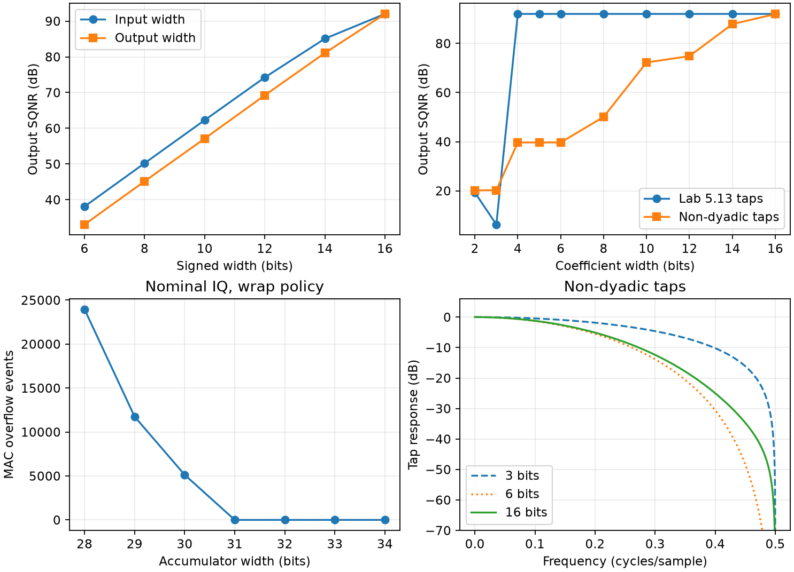

# Lab 4.5 — FIR word-length sweep

[Русская версия](../../ru/labs/lab-4-5-fir-word-lengths.md) · [Issue #94, phase 2](https://github.com/Lay007/zynq-sdr-course/issues/94)

Use the causal four-tap IQ filter from [Lab 5.13](lab-5-13-fir-architectures.md) to find which widths affect accuracy and which prevent overflow. [Lab 4.1](lab-4-1-fixed-point-fir.md) introduces coefficient quantization for a longer filter.

## Experiment

The reference convolves I and Q independently in float64. The model starts from zero history and changes one width at a time. The baseline uses signed Q1.15 for input, coefficients and output, and a 34-bit signed accumulator with 30 fractional bits. For input and coefficient widths Bx and Bh, the product has Bx + Bh − 2 fractional bits. In the accumulator sweep, the fractional width stays at 30 and only the signed range changes.

Round input and coefficients to nearest with ties toward positive infinity, then clip them to their signed range. Process the taps from newest to oldest. After each multiply and add, apply the selected accumulator overflow policy: two's-complement wrap or saturation. Round and clip once at the output. The accumulator and output counters count different events. An incorrect wrapped value can land inside the output range.

The nominal input is 8192 complex samples at 2.4 MS/s, with tones at 120 and 620 kHz, seeded additive I/Q noise and a peak magnitude of 0.80 relative to full scale. Error is calculated after the first three startup samples. The reported SQNR is the ratio of reference RMS to total output error RMS in dB. In overflow cases the error includes deterministic distortion. Tap-response metrics come from the quantized coefficients alone, with a 4096-point frequency grid. Use 0 to 0.10 cycles/sample as the comparison passband and 0.35 to 0.50 as the comparison stopband.

## Run

From the repository root, using the course Python environment:

```bash
python blocks/block_04_simulink_and_fixed_point/python/lab_4_5_fir_word_lengths.py --output build/lab45
python -m pytest tests/test_fir_word_lengths.py -q
```

The first command writes a plot and JSON with all sweep rows, thresholds, counts and units. The test compares the baseline to the same vectors as Lab 5.13 and exercises signed rounding and the accumulator endpoint.



[Full metrics JSON](../../assets/lab45_fir_word_lengths.json)

## Read the results

| Controlled change | Observation from the model |
| --- | --- |
| Input width, 8 to 16 bits | SQNR rises from 50.23 to 92.01 dB with all other widths at baseline. |
| Output width, 8 to 16 bits | SQNR rises from 45.17 to 92.01 dB under the same conditions. |
| Coefficient width, 3 to 4 bits | With Lab 5.13's taps, DC gain falls from 1.5 to the intended 1.0. Four bits already encode all four taps exactly. |
| Non-dyadic coefficients | For taps 0.113, 0.387, 0.387, 0.113, SQNR is 39.69 dB at 6 bits and 91.94 dB at 16 bits. Inspect the response as well as SQNR. The coarser taps can give stronger attenuation at some frequencies while changing the overall filter. |
| Accumulator width, 30 to 31 bits | The nominal waveform goes from 5129 overflowing MAC operations to zero. The exact Lab 5.13 tap codes are positive and sum to 32768, so a signed 31-bit accumulator also covers the analytical bounds for those fixed taps. |

The separate stress case repeats one IQ pair 64 times, uses four taps of −1, and tests the signed-product extremes. The positive I sum reaches 2³². With 33 accumulator bits, 61 MAC operations overflow. Wrap yields the wrong sign on those I outputs. A 34-bit accumulator has zero overflows, while the final output still clips 127 scalar I/Q components because the stress filter has gain magnitude 4 at DC. Saturation counts report clipping, not numerical correctness.

For hardware, narrower input and coefficient codes can reduce multiplier width, and a narrower accumulator can reduce register and adder width. DSP48E1 allocation depends on synthesis and the target, so these model results supply candidates for a tool run. Measured resources and routed timing for the original widths are in Lab 5.13.

## In your report

Record the width budget, coefficient set, amplitude, seed, error and all overflow and clip counters. Start with a target SQNR and propose the narrowest widths you tested that meet it in isolation. Then use `--widths` to check the combined effect. The arguments are input, coefficient, accumulator and output widths in that order.

```bash
python blocks/block_04_simulink_and_fixed_point/python/lab_4_5_fir_word_lengths.py --widths 12 4 15 12 --output build/lab45-combined
```

This example gives 67.95 dB and zero accumulator overflows on the nominal signal. The extra result is under `combined_nominal` in the JSON. State which input range and coefficient set your accumulator bound covers.
