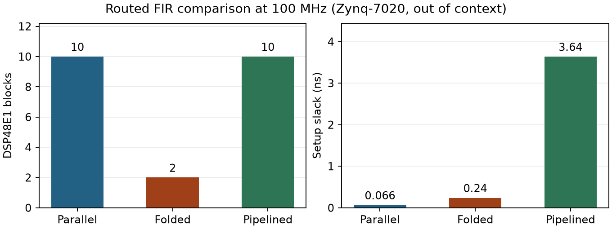

# Lab 5.13 — FIR architecture trade-offs

[Русская версия](../../ru/labs/lab-5-13-fir-architectures.md) · [Issue #94, phase 1](https://github.com/Lay007/zynq-sdr-course/issues/94)

Compare three hardware schedules for the four-tap IQ filter from [Lab 5.2](lab-5-2-fir-rtl-mapping.md). After [Lab 5.5](lab-5-5-float-fixed-rtl-comparison.md), use this experiment to choose a schedule for a sample-rate and DSP budget.

[Lab 4.5](lab-4-5-fir-word-lengths.md) sweeps the arithmetic widths independently of the RTL schedule.

## Same arithmetic and interface

For each of I and Q, compute `acc[n] = sum(h[k] * x[n-k], k=0..3)` and emit `clip((acc + 16384) >> 15, -32768, 32767)`, using an arithmetic shift. History starts at zero and advances only on an accepted IQ pair. Inputs, coefficients and outputs are signed Q1.15. Products have 30 fractional bits. Four products can sum to `+2**32`, so the accumulator has 34 signed bits. The final rounding rule sends ties toward positive infinity.

Drive one rising-edge clock and synchronous active-high reset. An input transfers when `in_valid && in_ready`. Keep the input stable while waiting for ready. The sink consumes every `out_valid` result on the rising edge. The design has no output backpressure or clock crossing. Hold the four coefficient ports stable during an operating interval and change them only during reset. Reset clears history and flushes pending results. Lab 5.2's taps `[4096, 12288, 12288, 4096]` remain the first test case. Exposing all four coefficients to Vivado prevents the comparison from becoming a test of constant-multiplier optimization.

| Variant | Schedule | Latency (clocks) | Initiation interval (clocks) | Schedule ceiling at 100 MHz (MS/s) |
| --- | --- | ---: | ---: | ---: |
| Parallel | All I/Q products, add tree and rounding ahead of the output register | 1 | 1 | 100 |
| Folded | Accept, then reuse one multiply-accumulate path per channel for four clocks | 5 | 5 | 20 |
| Pipelined | Register products, pair sums and final outputs | 3 | 1 | 100 |

Latency is the interval between the input transfer and the rising edge at which a downstream register can consume the result. The rate column is `f_clk / II` with continuous input and an always-available sink. Use timing results to judge whether that clock is achievable in the chosen context.

## Run the comparison

From the repository root, use Python 3.12+ and Icarus Verilog (`iverilog` and `vvp` on PATH). No FPGA board or vendor tools are needed for simulation.

```bash
python tools/run_fir_architectures.py --artifacts-dir build/fir-architectures-sim
```

Expect 474 exact matches per variant, each covering both I and Q. The scoreboard checks signed endpoints, a half-LSB tie, asymmetric impulse response, saturation, deterministic random samples, input gaps, sustained input and reset during active processing. Compare the latency and minimum initiation interval in the simulator logs.

For the optional routed comparison, install Vivado and put `vivado` on PATH. In Windows PowerShell use `vivado.bat` or its full path. Start the batch run from an isolated directory so that Vivado keeps its temporary data there.

```bash
mkdir -p build/fir-architectures-routed
cd build/fir-architectures-routed
vivado -mode batch -source ../../tools/vivado_fir_architectures.tcl -tclargs reports
cd ../..
```

From the repository root, combine the simulation and implementation results.

```bash
python tools/summarize_fir_architectures.py build/fir-architectures-routed/reports build/fir-architectures-sim build/fir-architectures-summary
```

The script targets `xc7z020clg400-2` and runs `synth_design`, `opt_design`, `place_design` and `route_design` with default directives for each mode of the same top-level module. The XDC specifies a 10 ns clock and 0 ns minimum and maximum external I/O delays. These delays model an abstract OOC boundary. Use the integrated design's clock network and constraints before drawing board timing conclusions. The summary requires that all routable nets were routed and the reported clock and I/O constraints cover the comparison.

## Compare results

--8<-- "reports/fpga/fir-architectures-table.md"

Vivado 2020.1 routed all three variants. Folding used 2 DSP48E1 blocks instead of 10, with additional LUTs and flip-flops for the multiplexers, controller and accumulators. The pipelined variant had the largest setup margin and still accepted one sample per clock. In the parallel version, the worst setup path reached the output register from a multiplier. In the pipeline, it started at a registered pair sum.

All three variants had input-to-register hold violations in the zero-delay OOC model. The worst originated at reset for the parallel variant and at an I input for the other two. The reports show no setup violations at 100 MHz, with hold closure still pending for this constraint set.



Use the [metrics JSON](../../assets/lab513_fir_architectures.json) to identify source hashes, tool version and routing results. These are Vivado out-of-context results at one target clock. An Fmax claim requires a period sweep and rerouting, and an RF claim would require a separate measurement.

## Report and review

Start from `templates/fir-architectures-report.template.md` in the repository. Record the coefficients, simulator version and exact-match count. Include latency and initiation interval, the Vivado version, FPGA part and XDC, DSP48E1/LUT/FF/BRAM counts and both setup and hold slack. Explain which implementation meets your assumed rate and resource budget. If the rate fit depends on an unclosed timing constraint, state that in the result.

Why can the folded variant consume fewer DSP blocks yet more LUTs? Which pipeline boundary moves the critical path? Why does a positive setup slack alone fail to establish timing closure? Do not equate a longer pipeline latency with a longer initiation interval, and check negative half-LSB cases before comparing with a model that rounds ties to even.
