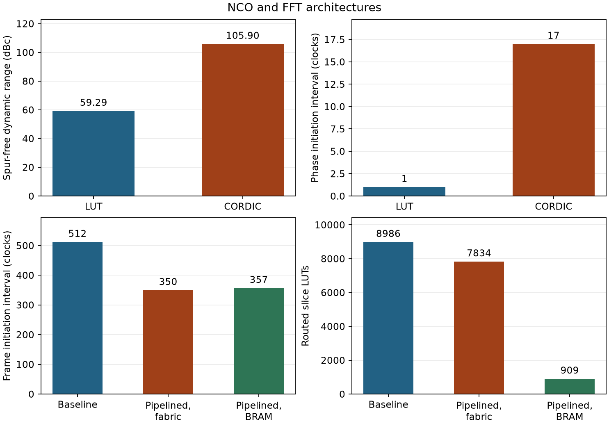

# Lab 5.14 — NCO and FFT architectures

[Русская версия](../../ru/labs/lab-5-14-nco-fft-architectures.md) · [Issue #94, phase 3](https://github.com/Lay007/zynq-sdr-course/issues/94)

Compare two phase-to-IQ converters and three schedules for the same 64-point FFT. Use [Lab 5.3](lab-5-3-nco-mixer-rtl.md) for the NCO/mixer background and [Lab 8.14](lab-8-14-ofdm-rtl-chain.md) for the receiver that uses this FFT.

## Compare the NCO converters

Both converters accept a 32-bit phase word modulo one turn and return signed Q1.15 cosine and sine with amplitude 7/8 of full scale. A common external accumulator supplies the test phases. The table uses the ten most significant phase bits and stores 257 entries for a quarter turn. The iterative CORDIC uses 16 shift-and-add steps, with quadrant reduction and gain correction through the starting vector. The converters implement the same interface, including synchronous active-high reset and `phase_valid && phase_ready`. The sink consumes every valid output.

The testbench checks 4108 phase words per converter against integer reference outputs. Twelve cases sit on and next to quadrant boundaries. It checks ready, valid, reset during calculation and latency from input acceptance to output consumption.

For the spectrum, take the 4096 output samples of a coherent complex tone at bin 197 with a fixed starting phase. Use a rectangular window and measure `20 log10(tone magnitude / largest other bin magnitude)` over the two-sided spectrum. Measure phase error against the ideal complex phasor for all 4108 words. SFDR can change with the tuning word and phase truncation, so repeat the test with a different coherent bin before generalizing.

| Converter | Latency and initiation interval (clocks) | Max. phase error (degrees) | SFDR (dBc), bin 197 |
| --- | ---: | ---: | ---: |
| Quarter-wave table | 1 | 0.3517 | 59.29 |
| Iterative CORDIC | 17 | 0.00277 | 105.90 |

At the same clock, the table accepts a phase every cycle and the iterative CORDIC every 17 cycles. For the same output sample rate the CORDIC needs a faster clock or additional parallelism. The phase accumulator itself is external to both routed blocks.

For bin 256, each phase increment is exactly 64 LUT address steps. The discarded phase fraction stays constant across the coherent tone. In this run, SFDR was 101.27 dBc for the table and 99.18 dBc for CORDIC. This illustrates why one tuning word cannot establish the worst-case SFDR.

## Compare the FFT schedules

All variants use the same RX FFT and implement `FFT(x)/64` in signed Q1.15 through the normalized inverse transform and conjugation. Six radix-2 stages each divide by two with fixed-point rounding. The one-clock butterfly and the pipelined butterfly share the same arithmetic. The pipelined mode can store working points in logic or in two block-RAM banks selected by address parity. Points in a radix-2 pair differ in one address bit and therefore occupy different banks.

Feed two consecutive frames with 64 IQ samples each. Measure the clocks between the first input handshake and the first output handshake, and the clocks between the starts of the two frames. Repeat with input gaps and a stalled sink to check output stability, order and frame boundaries. Both runs compare 128 complex bins per mode against the committed fixed-point vector and check for zero saturation. The largest component error versus NumPy on the test frame is 1.754 LSB rounded up to three decimals.

| Schedule | Compute clocks | First input to first bin (clocks) | Frame initiation interval (clocks) |
| --- | ---: | ---: | ---: |
| One-clock butterfly, logic | 384 | 448 | 512 |
| Pipelined butterfly, logic | 222 | 286 | 350 |
| Pipelined butterfly, BRAM | 229 | 293 | 357 |

The initiation interval includes loading and draining the frame because this core processes one frame at a time. For continuous input and output the schedule ceiling is `64 × f_clk / frame_ii` complex samples per second. Apply the actual timing constraints before selecting a clock. On the BRAM schedule, the extra clocks account for registered memory reads.

## Reproduce the comparison

From the repository root, run Python with NumPy and Icarus Verilog on PATH. The first command generates the NCO ROM, simulates the two NCO variants and compares the three FFT schedules. The second checks scaled FFT arithmetic against independent NumPy calculations.

```bash
python tools/run_dsp_architectures.py
python -m pytest tests/test_ofdm_fft_fixed.py -q
python tools/run_dsp_architectures.py --family nco --tone-bin 256 --output build/dsp-nco-bin256
```

Optional Vivado run with `vivado` on PATH. On Windows use `vivado.bat` or its full path. Run each family in its own working directory.

```bash
mkdir -p build/dsp-nco-ooc build/dsp-fft-final
cp build/dsp-architecture-sim/nco_quarter_q15.mem build/dsp-nco-ooc/
cd build/dsp-nco-ooc
vivado -mode batch -source ../../tools/vivado_dsp_architectures.tcl -tclargs nco reports
cd ../dsp-fft-final
vivado -mode batch -source ../../tools/vivado_dsp_architectures.tcl -tclargs fft reports
cd ../..
python tools/summarize_dsp_architectures.py build/dsp-architecture-sim build/dsp-nco-ooc/reports build/dsp-fft-final/reports build/dsp-summary
```

The implementation uses original course RTL, inferred memories and multipliers, one `xc7z020clg400-2` part, a 10 ns clock and zero external I/O delays. There is no separately licensed FFT or CORDIC IP. The clock and port delays model an abstract out-of-context boundary.

## Routed results and interpretation

--8<-- "reports/fpga/dsp-architectures-table.md"



[Metrics, results and source hashes](../../assets/lab514_dsp_architectures.json)

Explain how many phases per second your NCO needs, whether the measured spur matters at that tuning word, and how many FFT frames the interface can carry. Include DSP48E1, LUT, FF, BRAM and both setup and hold slack. A higher simulated throughput cannot make up for a failed timing constraint. These Vivado runs cover the standalone blocks, with board clocking and RF validated separately.
