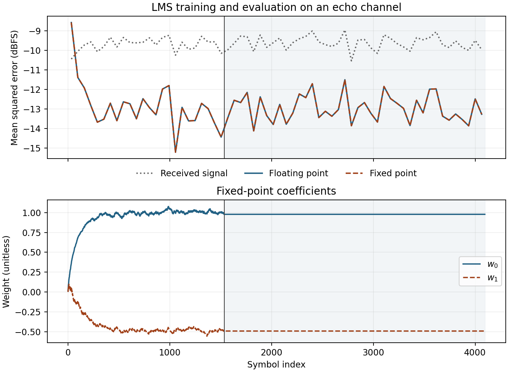

# Lab 5.15 — Two-tap LMS equalizer

[Русская версия](../../ru/labs/lab-5-15-lms-equalizer.md) · [Issue #94, phase 4](https://github.com/Lay007/zynq-sdr-course/issues/94)

Train a two-tap least mean squares (LMS) equalizer on a known BPSK sequence, then freeze the coefficients and score the following symbols. The model assumes one real sample per symbol and known symbol timing. See [Lab 5.13](lab-5-13-fir-architectures.md) for the fixed-coefficient FIR background.

## Model and fixed-point arithmetic

Generate 4096 equiprobable BPSK symbols `d[n]` with amplitudes ±0.5 of full scale. Use NumPy's generator with seed 9415 and form `x[n] = 0.8 d[n] + 0.62 d[n−1] + noise[n]`, with zero initial history and Gaussian noise of standard deviation 0.045 of full scale. Compute the estimate `y = w₀ x[n] + w₁ x[n−1]` and error `e = d[n] − y` for each symbol. Start both weights at zero and add `e x / 16` to each weight using its corresponding input. Update the coefficients for the first 1536 symbols and retain the final values for the remaining 2560.

The integer model and RTL use signed Q1.15 samples and targets, signed Q2.14 weights and a 33-bit sum of products. Round the estimate to a signed 19-bit value with 15 fractional bits and keep that format for the feedback error. The gradient products have 30 fractional bits. Shifting right by 20 applies the step size and converts the increment to Q2.14. Both right shifts round to nearest with ties toward positive infinity. Each weight saturates to the signed 16-bit range after addition. A shared flag marks a sample if either weight saturates.

At a rising edge with `in_valid` high, the core registers the estimate and advances the sample history. If `train` is also high, it commits the updated weights at the same edge. The estimate uses the weights from before that edge. A downstream register samples `out_valid` and the result at the next rising edge. Synchronous active-high reset clears state and suppresses output valid. In simulation the circuit accepts a sample every clock and expects the sink to consume every valid output.

## Reproduce and inspect

From the repository root, use Python with NumPy and Matplotlib. For the RTL check, add Icarus Verilog to PATH.

```bash
python tools/run_lms_equalizer.py --rtl
```

Omit `--rtl` for the numerical experiment alone. By default the script writes both language versions of the plot and a metrics JSON to `build/lms-sim/`. In RTL mode it also writes the stimulus and simulator log. The testbench checks valid, estimate, both weights and the saturation flag on all 5257 cycles, including 5122 valid samples. It covers input gaps, reset priority, coefficient freeze with deliberately wrong targets, both saturation rails and a positive sum at the full-scale signed input limit. Each saturation sequence produces 158 flags.

## Evaluation with frozen weights

Measure mean squared error relative to the transmitted amplitudes, without adjusting the gain of the received signal. Decide bits by sign and count errors over the same 2560 symbols.

| Signal | Mean squared error (FS²) | Bit errors | BER in this run |
| --- | ---: | ---: | ---: |
| Received | 0.109634 | 24 | 0.9375% |
| Floating-point equalizer | 0.051210 | 2 | 0.078125% |
| Fixed-point equalizer | 0.051212 | 2 | 0.078125% |

The fixed-point weights freeze at approximately `[0.978210, −0.492432]`. Input quantization and weight updates stay within their ranges in the BPSK run. The graph shows mean squared error in blocks of 64 symbols and the fixed-point weights. Shading marks the evaluation interval. The BER comes from one generated sequence and noise realization.



## Routed timing

Optionally run Vivado on `xc7z020clg400-2` with a 10 ns clock and zero external I/O delays. Use `vivado.bat` or its full path on Windows.

```bash
mkdir -p build/lms-ooc-final
cd build/lms-ooc-final
vivado -mode batch -source ../../tools/vivado_lms_equalizer.tcl -tclargs reports
cd ../..
```

From the repository root, combine the simulation and implementation results.

```bash
python tools/run_lms_equalizer.py --rtl --reports build/lms-ooc-final/reports --output build/lms-evidence
```

Vivado 2020.1 routed the out-of-context core with 4 DSP48E1 blocks, 161 LUTs, 69 flip-flops and no BRAM. At the target period, setup WNS was −6.750 ns and hold WHS was −0.266 ns. The worst setup path lies in the coefficient feedback loop. The worst hold path starts at the reset input under the abstract I/O constraints. Adding a feedback register would delay the update seen by later symbols and requires a corresponding change to the reference model or input schedule. The [metrics JSON](../../assets/lab515_lms_equalizer.json) records the tool version and source hashes. This experiment covers synthetic data, RTL simulation and out-of-context routing. Board timing and RF performance remain unmeasured.

## Analyze your result

Calculate the BER from the frozen interval. Including the training interval mixes two different coefficient policies, and enabling updates in the frozen interval leaks the known targets into the evaluation.

1. Which terms remain when you convolve the two frozen weights with the two channel taps? How do they explain the residual error?
2. Why does freezing the weights still require advancing the input history?
3. If the feedback calculation takes two clocks, how would you schedule inputs so that each symbol still uses the weights updated by the preceding symbol?
