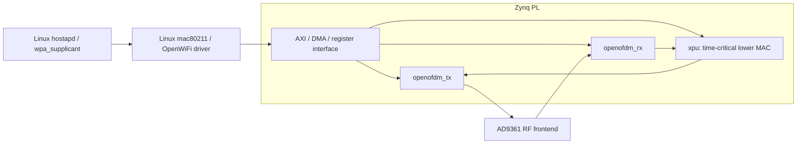

# OpenWiFi PHY/MAC Engineering Track

> **Status: proposed elective; documentation and feasibility planning only (2026-11-12).** No OpenWiFi boot, FPGA implementation, RF interoperability, CSI collection, or benchmark has been validated on the course's physical ZynqSDR boards.

[Русская версия](../ru/openwifi-engineering-track.md) | [Tracking issue #92](https://github.com/Lay007/zynq-sdr-course/issues/92) | [ADR 0005](../adr/0005-openwifi-engineering-track.md)

## Why this track

The existing twelve-block course teaches a reproducible **reference model -> fixed-point -> RTL/testbench -> FPGA -> RF -> measurement** route. OpenWiFi is an optional advanced case study that extends the QPSK and OFDM labs to interoperable packet communication and practical MAC behavior.

[OpenWiFi](https://github.com/open-sdr/openwifi) implements an SDR-based Linux `mac80211`-compatible 802.11 stack. [openwifi-hw](https://github.com/open-sdr/openwifi-hw) contains FPGA/RTL sources. The open implementation covers OFDM-based **802.11a/g** and a **limited 802.11n, 20 MHz, single-stream** path; it does **not** implement legacy 802.11b support or claim complete 802.11n/Wi-Fi 6 feature coverage. Advanced features advertised commercially by upstream are not assumed to be open-source course capabilities.

Upstream lists several Zynq-7020 + AD936x-related platforms, but our **FISH Ball PlutoSDR Rev.A / Zynq-7020 + AD9361** board is **not thereby a proven drop-in target**. The exact board design, interface, boot flow, clocks, IP licenses and Linux software must be investigated.

## Architecture to study

The diagram is conceptual and omits board-specific DMA, clocks, interrupts and the ADI reference design integration. The FPGA lower MAC implements tight timing functions such as channel access / acknowledgments; Linux provides the higher MAC control and network-facing interface. Real clock-domain and DMA boundaries must be checked against a pinned upstream revision.

## Learning units (proposed IDs, not registered labs)

| Unit | Existing course bridge | Deliverable and acceptance evidence |
| --- | --- | --- |
| **WIFI-1: OFDM PHY** | Block 8, Labs 8.5 and 8.10 | Deterministic MATLAB/Python 802.11a/g OFDM symbol and packet models: 64-point FFT, pilot/data tones, cyclic prefix, BPSK/QPSK/QAM, PAPR, EVM; compare with independently generated reference vectors. |
| **WIFI-2: Packet RX** | Blocks 7–9 | Packet detector, short/long training sequences, coarse/fine CFO, timing, channel estimation, equalization, deinterleaving, demapping, Viterbi decoding, descrambling and FCS/CRC; demonstrate a valid decoded test frame and negative cases. |
| **WIFI-3: RTL and fixed-point** | Blocks 4–5 | Inspect/simulate `openofdm_tx` / `openofdm_rx` components where practical; record scaling, signedness, latency, resource/timing constraints, and bit-exact or explicitly bounded differences from the reference model. |
| **WIFI-4: Board integration** | Blocks 5–7, 11 | Read-only inventory, board porting matrix, isolated experimental Linux/FPGA boot profile, successful AD9361 bring-up and a usable `sdr0` interface; evidence required before claiming success. |
| **WIFI-5: PHY + MAC in the field** | Blocks 7, 11 | Controlled AP/STA association, packet captures, throughput, latency, retransmissions and packet error rate against MCS / attenuation; separate PHY rate, MAC efficiency and IP throughput. |
| **WIFI-6: CSI and sensing** | Blocks 9, 12 | Timestamped channel state/frequency-offset/equalizer captures; static-vs-motion comparison with uncertainty and limitations; no unverified localization accuracy claims. |

These IDs deliberately avoid renumbering existing Block 8 and Block 11 labs. Each implemented unit should later follow the repository's normal RU/EN lab-page, script, report and CI conventions.

## Delivery stages and explicit evidence gates

1. **Feasibility (no board mutation).** Record upstream source/tag/commit hashes for `openwifi`, `openwifi-hw`, and `openwifi-hw-img`. Compare the supported board reference designs with our board: AD9361 digital interface, clock/reset, PS MIO, DDR, AXI address map, DMA, interrupts, DTB, kernel/driver ABI, and boot mode. Record exact Vivado/Vitis/IP-license requirements. The upstream Viterbi Decoder evaluation license may time-limit continuous operation: check license status before prolonged tests.
2. **Offline PHY (hardware-independent).** Publish a deterministic 802.11a/g IQ generator and receiver reference with test vectors, seeds, modulation/coding metadata, expected decoded frame/FCS, CFO/EVM/PER and regression tests. Distinguish simulated channel impairments from RF measurements.
3. **RTL comparison.** Inspect upstream block-level testbenches and resource/timing reports, run only reproducible licensed configurations, and produce comparison reports. No vendor-only tool must become mandatory for the course's normal smoke path.
4. **Isolated port.** Keep the existing [firmware-profile ADR](../adr/0004-zynqsdr-firmware-profiles.md) intact. Propose an `openwifi-experimental` profile only after documenting each board's current boot and **tested** recovery procedure. The [hardware bundle](../../hardware/7020_ad936x_sdr/README.md) already records AD9361 calibration timeouts for some rebuilt PL payloads: a successful FPGA load alone is *not* a passed board bring-up.
5. **RF and MAC measurements.** Begin with RX-only and cabled/attenuated tests. Record frequency, bandwidth, sample rate, gain, attenuation, image hashes and environment. Only then test association and throughput. Maintain the local spectrum regulations and [RF safety guide](../rf-safety.md). Never directly connect TX to RX without verifying the attenuation and receiver power budget.
6. **CSI elective.** Reuse upstream [CSI](https://github.com/open-sdr/openwifi/blob/master/doc/app_notes/csi.md) and [self-CSI sensing](https://github.com/open-sdr/openwifi/blob/master/doc/app_notes/radar-self-csi.md) documentation as research references, not as evidence that sensing works on our board. Explain packet timestamps, CFO and channel-response estimates. At 20 MHz bandwidth, nominal delay resolution is fundamentally coarse; high-accuracy ranging needs additional verified methods.

## Measurement and reproducibility contract

Every reported hardware test must identify board A/B, firmware/kernel/driver/RTL source revisions and image SHA-256, boot method, operating mode (AP/STA/monitor), center frequency (Hz), channel bandwidth (Hz), sample rate (samples/s), gain (dB), RF attenuation (dB), antenna/cable path, MCS, packet counts, reference timestamps and analysis commands.

Report **PHY bit error rate (BER)**, **packet error rate (PER)**, **error vector magnitude (EVM)**, **carrier frequency offset (CFO)**, **MAC retries**, **IP throughput (Mbit/s)** and **latency (ms)** with their exact measurement layers and denominators. Do not convert an upstream benchmark into a measured course-board result. Keep synthetic, RTL, timing, boot, RF and application evidence as distinct labels.

- **Offline gate:** deterministic vectors decode and negative tests fail as expected.
- **FPGA gate:** reported RTL/tool versions, utilization, timing constraints and passing self-checks.
- **Boot gate:** kernel logs, AD9361 calibration, correct clocks, `sdr0` and board-specific rollback evidence.
- **RF gate:** actual client association/data exchange, packet capture, measured metrics, channel safety and reproducibility metadata.
- **CSI gate:** timestamps matched to packets, static baseline, repeated observations, documented confounders and uncertainty.

## Repository and license boundary

Keep educational *original* models, documentation, test vectors, scripts and small reports in `zynq-sdr-course`. Keep board-specific boot images, proprietary/vendor cores, recovery dumps and large captures in the appropriately controlled artifact store following [ADR 0003](../adr/0003-binary-artifact-repository-boundary.md). Do not import substantial upstream AGPL-3.0-or-later HDL/software sources into this MIT-licensed repository without a specific license-compliance review. Reference exact upstream revisions instead; third-party IP licenses may impose further limitations.

## References

- [OpenWiFi software and documented features](https://github.com/open-sdr/openwifi)
- [OpenWiFi FPGA design and supported boards](https://github.com/open-sdr/openwifi-hw)
- [OpenWiFi prebuilt hardware outputs](https://github.com/open-sdr/openwifi-hw-img)
- [OpenWiFi 802.11n feature notes](https://github.com/open-sdr/openwifi/blob/master/doc/app_notes/ieee80211n.md)
- [Course OpenWiFi tracking issue #92](https://github.com/Lay007/zynq-sdr-course/issues/92)
