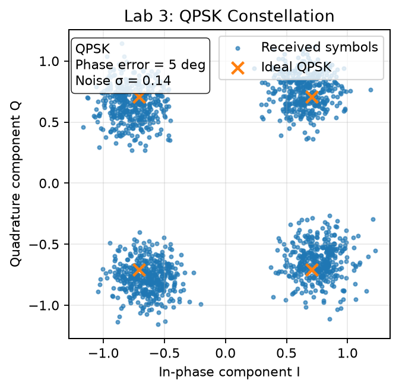

# Lab 3: QPSK → Constellation → Impairments

Lab 3 introduces digital modulation and visualization through constellation diagrams.

---

## Goal

```text
bitstream → QPSK modulation → RF transmission → IQ capture → constellation → quality metrics
```

---

## Experiment flow


---

## Typical impairments

| Impairment | Visual effect |
|---|---|
| Noise | cloud spreading |
| Phase offset | rotation |
| CFO | slow rotation over time |
| IQ imbalance | ellipse |
| Clipping | distorted clusters |

---

## Demo figure



---

## Engineering takeaway

A constellation shows several impairments at once: noise spreads the clusters, a carrier offset rotates them, IQ imbalance turns them into an ellipse, clipping distorts them. That is why it is usually the first plot to look at when a link misbehaves.
