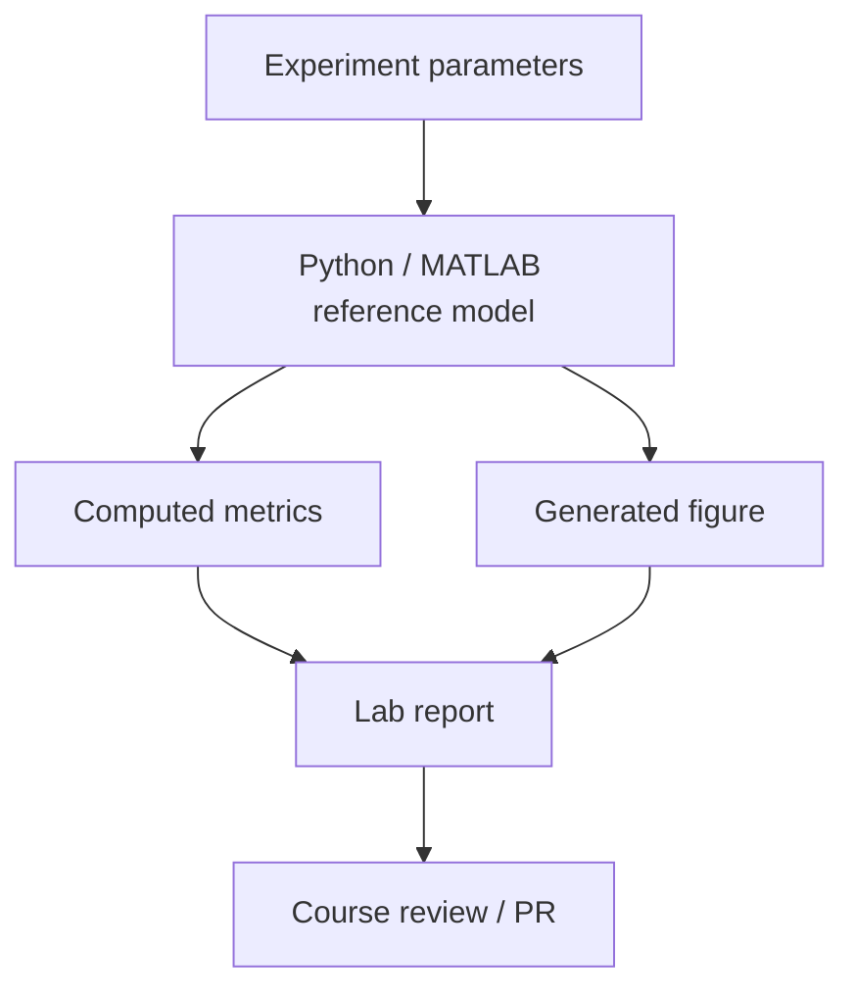

# Reproducibility guide

This guide explains how to rebuild the documentation, regenerate figures and keep lab results traceable.

## Local documentation build

The CI baseline is Python 3.12. Create an isolated environment from the repository
root with your chosen Python interpreter:

```bash
python -m venv .venv
```

On Linux or macOS:

```bash
source .venv/bin/activate
python -m pip install -r requirements-dev.txt
python tools/tasks.py docs
```

On Windows PowerShell, call the environment's interpreter directly. Activation
and execution-policy changes are not required:

```powershell
.\.venv\Scripts\python.exe -m pip install -r requirements-dev.txt
.\.venv\Scripts\python.exe tools/tasks.py docs
```

The commands below use `python` from the activated environment. In PowerShell,
replace it with `.\.venv\Scripts\python.exe`. Dependencies come from the same
pinned requirements as CI. A successful docs check ends with `Documentation
built`; strict mode reports configured documentation warnings as failures.

Preview locally with `python tools/tasks.py serve`.

## Choose local checks

| Command | Scope | Required tools |
|---|---|---|
| `python tools/run_local_ci.py --software-only` | Ruff, lab ID registry and pytest; no HDL simulation | Development requirements |
| `python tools/tasks.py docs` | Strict MkDocs build | Development requirements |
| `python tools/run_local_ci.py --hdl-only` | Canonical Block 5, CSS and default OFDM regressions | Development requirements, `iverilog` and `vvp` |
| `python tools/run_local_ci.py` | Software checks, docs, representative labs and HDL | All of the above |

`--quick` retains its earlier behavior: software checks and HDL, without docs or
lab rebuilds. It can take many minutes. The modes are mutually exclusive. None
of these checks connects to a board; RF acceptance follows the measured-work
criteria in the [completion table](v1-completion-gates.md).

For a focused Block 5 regression with persistent diagnostic files:

```bash
python tools/run_block5_hdl_smoke.py --test tb_iq_passthrough --artifacts-dir build/hdl/block5
```

Each test writes compile and simulation stdout/stderr logs to its own directory.
VCD files produced by that test are copied before the temporary workspace is
removed, including on a failed simulation or timeout. CI uploads this directory
even if a test fails. Existing files in the chosen directory are not cleaned;
use a separate output directory for each run when comparing results.

`make clean` delegates to `python tools/tasks.py clean`. Both preserve tracked
evidence and inputs, including the documented `iq_passthrough_vectors.txt`.

## SSH board commands

The shared Paramiko runner loads `~/.ssh/known_hosts` and rejects unknown or
changed board keys. Verify the board's host-key fingerprint over a trusted path
(for example, the serial console), then register that key using your normal SSH
client before running the labs. A re-imaged board may need its verified key
updated. Blindly accepting `ssh-keyscan` output does not verify its identity.

The runner's `timeout_s` limits each connection phase and the total runtime of
each command. Lab 11.7 exposes it as `--ssh-timeout-s` (default 10 seconds).
Increase the caller's timeout for an intentionally longer capture or wait.
Timeout closes the SSH channel; it does not guarantee that the remote process
has stopped or that RF state has been restored. Use the lab's documented board
cleanup procedure after an interrupted experiment.

## Figure generation

The repository uses IEEE-style generated figures. The expected workflow is:

```bash
python tools/generate_ieee_plots.py
```

After generation, verify that the following paths are updated only when the corresponding lab data or plotting logic changed:

```text
docs/assets/lab01_fft.png
docs/assets/lab02_am_vs_fm.png
docs/assets/lab03_constellation.png
docs/assets/lab04_sync_constellation.png
docs/assets/lab05_evm.png
docs/assets/lab06_ber.png
```

## Block 4 executable labs

Block 4 contains executable fixed-point labs. Install the Python dependencies:

```bash
python -m pip install -r requirements-dev.txt
```

Run the labs:

```bash
python blocks/block_04_simulink_and_fixed_point/python/lab_4_1_fixed_point_fir.py
python blocks/block_04_simulink_and_fixed_point/python/lab_4_2_fixed_point_digital_mixer.py
```

Expected generated figures:

```text
docs/assets/lab41_fixed_point_fir_response.png
docs/assets/lab41_fixed_point_fir_spectrum.png
docs/assets/lab41_fixed_point_fir_error.png
docs/assets/lab42_fixed_point_mixer_spectrum.png
docs/assets/lab42_fixed_point_mixer_error.png
docs/assets/lab42_nco_frequency_resolution.png
```

The GitHub Actions workflow `.github/workflows/block4_labs.yml` runs these Python labs and validates that all expected figures are generated.

## Recommended lab execution flow



## Reproducible lab package

Each lab should eventually provide:

```text
lab-name/
  README.md
  python/
    run_lab.py
  matlab/
    run_lab.m
  cpp/
    CMakeLists.txt
    main.cpp
  data/
    README.md
  figures/
    generated_plot.png
  report/
    lab_report.md
```

For small labs, the files may remain in shared `examples/`, `tools/` and `docs/assets/` folders, but the report must clearly reference the exact scripts and figure paths.

## Metrics reproducibility

| Metric | Required reproducibility notes |
|---|---|
| FFT peak | sample rate, FFT length, window, normalization |
| SNR | signal band, noise band, exclusion region around carrier |
| EVM | reference symbols, synchronization method, RMS normalization |
| BER | bit mapping, frame alignment, number of compared bits |
| Frequency error | estimator method, averaging interval, expected frequency |
| Fixed-point error | reference type, word length, scaling, saturation/wrap mode |

## IQ recording reproducibility

Every real IQ recording must include metadata:

```text
capture_name.ci16
capture_name.json
```

The metadata file should follow the [IQ recording metadata guide](iq-recording-metadata.md).

## Vivado implementation evidence

Vivado 2021.1 is the tested version for the XC7Z020 course design. A full rebuild can take tens of minutes:

```powershell
python tools/generate_integrated_vivado_reports.py --build
```

The command recreates the project, generates the bitstream and publishes normalized utilization, timing, clock and route reports under `reports/fpga/integrated_zynq_raw/`. It fails if metrics cannot be parsed, timing is not met or the design is not fully routed. The large generated bitstream remains local; its size and SHA256 are recorded in the metrics JSON.

## Pull request checklist

Before merging a lab or course update, check:

- `mkdocs build --strict` passes;
- all new pages are linked from `mkdocs.yml`;
- generated figures are referenced from at least one page;
- scripts have deterministic parameters or documented random seeds;
- real IQ data is not committed if it is too large;
- large recordings are stored externally or through Git LFS with a small metadata stub;
- the lab includes a short engineering conclusion.

## CI target

The ideal CI pipeline should contain these jobs:

| Job | Purpose |
|---|---|
| `docs-build` | Run `mkdocs build --strict` |
| `plot-generation` | Regenerate IEEE-style figures |
| `block4-labs` | Run fixed-point Python labs and validate generated figures |
| `link-check` | Validate internal and external links |
| `python-labs` | Run Python examples and smoke tests |
| `cpp-labs` | Build C++ examples with CMake |
| `metadata-check` | Validate IQ metadata JSON files |

## Determinism rules

- Use fixed random seeds for generated examples.
- Store figure-generation parameters near the script.
- Do not manually edit generated images.
- Prefer small synthetic datasets for CI.
- Keep real recordings documented but avoid repository bloat.
