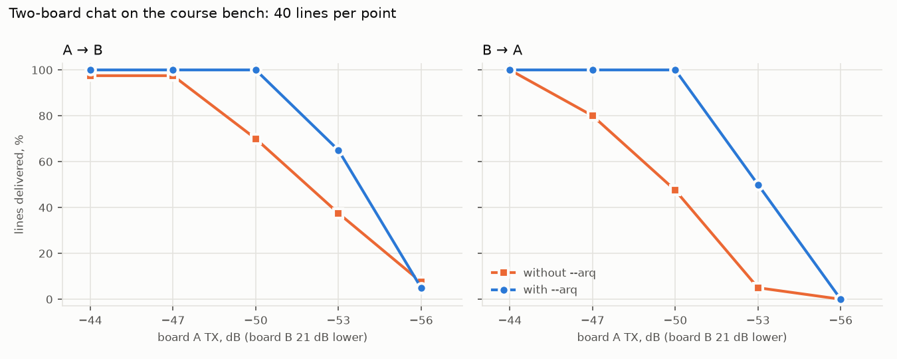

# Лабораторная 11.51 — Подтверждения: отправитель узнаёт, что потерялось

## Идея

Чат Лабораторной 11.50 отправляет каждую строку один раз и надеется. На стенде курса при уровнях
по умолчанию этого хватает, но стоит убавить передатчики, и строки начинают исчезать бесследно:
отправитель печатает `>>`, другая плата не печатает ничего, и никто об этом не знает. Эта
лабораторная добавляет старейшее средство канального уровня. Приёмник отвечает на каждую строку, а
отправитель повторяет строку, пока не придёт ответ. Это около сотни строк на C поверх Лабораторной
11.50, в ПЛИС не меняется ничего.

Интереснее всего то, чего ответы сделать не могут. Отправитель, не получивший ответа, не может
понять, потерялась его строка или ответ, и на стенде эта неоднозначность видна прямо в цифрах.

## Протокол

```text
отправитель                                 приёмник
строка, номер s      ------------------>    новый s?  вывести
                     <------------------    ACK, номер s         (на каждую копию, новую или нет)
нет ACK за 0,6 с: отправить строку снова, не больше 5 раз
```

- **Подтверждение это отдельный кадр.** Обычный кадр packet-v1 с полезной нагрузкой в один байт,
  `0x06` (ASCII ACK), и номером строки, на которую он отвечает. Набранная строка никогда не
  начинается с этого байта, поэтому приёмник различает их без поля типа.
- **Приёмник подтверждает каждую копию.** Если его первое подтверждение потерялось, отправитель
  пришлёт строку снова, и приёмник, промолчавший потому, что уже видел эту строку, заставил бы
  отправителя сдаться.
- **Приёмник выводит строку один раз.** Номер отличает повтор от новой строки.
- **Номера начинаются со случайного значения.** Иначе чат, перезапущенный на одной плате, начал бы с
  номеров, которые другая плата только что видела, и его первые строки отбросились бы как повторы.

## Что нужно

Стенд Лабораторной 11.50: две платы с образом `issue70-listen-window` (результаты ниже сняты на
`issue69-listen-silent`), два кабельных пути,
`/root/zmbox` на обеих платах, собранный из `blocks/block_11_integrated_sdr_project/sw/zmbox.c`.
Подтверждения это режим той же программы:

```text
board-a$ ./zmbox chat --name A --arq --tx-gain -30
board-b$ ./zmbox chat --name B --arq --tx-gain -50
```

## Канал, который теряет строки

Чтобы увидеть подтверждения в работе, сделайте канал плохим. На стенде курса плата A на TX −50 дБ и
плата B на TX −71 дБ теряют около 40 % строк (путь B -> A идёт без сплиттера, поэтому плате B нужно
на 21 дБ меньше). Обмен по сценарию на этих уровнях, записанный на стенде:

```text
плата A                                                   плата B
>> A: hello, B here?                                      << A: hello, B here?
<< B: yes, hearing you, A                                 >> B: yes, hearing you, A   (acknowledged after a repeat)
>> A: loud and clear   (no acknowledgement after 5 tries)
<< B: what carrier?                                       >> B: what carrier?   (acknowledged after a repeat)
>> A: 915 MHz, conducted   (acknowledged after a repeat)  << A: 915 MHz, conducted
<< B: nice. signing off                                   >> B: nice. signing off
>> A: bye   (acknowledged after a repeat)                 << A: bye
```

(Консоли показаны рядом; строки подавал скрипт, поэтому самого набранного текста нет.) Четырём
строкам понадобился повтор, и они дошли. «loud and clear» не дошла за 5 попыток, и плата A об этом
сказала. В этом весь выигрыш: потерянная строка больше не теряется молча.

То же сравнение, посчитанное скриптом Лабораторной 11.50:

```bash
cd blocks/block_11_integrated_sdr_project/python
python two_board_chat.py --rounds 60 --tx-gain-a -50 --tx-gain-b -71 --json-out plain.json
python two_board_chat.py --rounds 60 --tx-gain-a -50 --tx-gain-b -71 --arq --json-out arq.json
```

На стенде курса, по два прогона, всего 100 раундов:

| | A -> B | B -> A |
|---|---:|---:|
| без `--arq` | 60 из 100 | 61 из 100 |
| с `--arq` | 100 из 100 | 99 из 100 |

С `--arq` 52 строкам платы A и 45 строкам платы B понадобился хотя бы один повтор. Ни одна строка
не пришла искажённой и ни одна не была выведена дважды. При уровнях по умолчанию подтверждения
почти ничего не стоят: 30 из 30 строк в каждую сторону, всего 4 повтора.

## Когда теряется ответ

За эти 100 раундов на плохом канале отправители 8 раз сообщили «no acknowledgement after 5 tries».
По-настоящему потерялась только одна из этих строк. Остальные семь дошли, а обратно не дошло
подтверждение. Отправителю их не различить: в обоих случаях он просто ничего не слышит.

Это не ошибка чата. По каналу, который может терять кадры в обе стороны, никакой конечный обмен
сообщениями не даёт обеим сторонам уверенности в одном и том же: каждому подтверждению понадобилось
бы своё подтверждение. Поэтому протокол выбирает, что он может обещать. Этот обещает, что строка,
которую отправитель назвал подтверждённой, дошла, и что потерянная строка никогда не теряется
молча. Он не обещает, что «нет подтверждения» значит «не доставлено».

## Нужны оба направления

То же сравнение на разных уровнях, плата B всегда на 21 дБ ниже платы A, 40 строк на точку:



До −50 дБ у платы A подтверждения доставляют каждую строку, там, где простой чат теряет до половины.
Шагом ниже, на −53/−74 дБ, появляется новое. Плата B вывела 26 из 40 строк платы A, а плата A
назвала 36 своих строк неподтверждёнными. Подтверждения на строки платы A идут от B к A, а на этом
уровне направление B -> A само доставляло 2 строки из 40. Протокол, который держится на ответах,
хорош ровно настолько, насколько хорошо худшее из двух его направлений.

## Что попробовать

- Наберите строки на обеих платах одновременно. Модем полудуплексный: пока плата передаёт и слышит
  собственную пачку, она не может принимать, так что первые попытки сталкиваются. На стенде курса
  это стоило почти каждой строке платы B одного повтора, но ни одна строка не потерялась, а
  случайная добавка к ожиданию перед повтором (`zmbox` добавляет до 0,5 с; `ZMBOX_ARQ_BACKOFF=0`
  её отключает) не дала заметной разницы: после первого столкновения платы уже не идут в ногу.
  Запуск: `two_board_chat.py --arq --b-offset 0`.
- Поменяйте `ARQ_TRIES` или `ARQ_WAIT_S` в `zmbox.c`. Меньше попыток теряет больше строк; более
  короткое ожидание шлёт повтор раньше, чем подтверждение могло бы прийти (ему нужно не меньше
  140 мс ожидания из Лабораторной 11.50 плюс сама пачка).

## Задания

1. Зачем приёмник подтверждает строку, которую уже вывел?
2. Что пошло бы не так, если бы каждый чат начинал с номера 1?
3. Отправитель сообщает «no acknowledgement after 5 tries». Что он может заключить о строке, а что
   нет?
4. Повторы идут с постоянным интервалом. Почему две платы, говорящие одновременно, могут раз за
   разом терять строки друг друга, и как это обычно лечат?

<details markdown="1">
<summary>Ответы</summary>

1. Потому что потеряться могло его подтверждение. Отправитель знает только, что ничего не услышал,
   и шлёт строку снова; если бы приёмник молчал о строках, которые у него уже есть, отправитель
   повторял бы, пока не сдастся, и затем назвал бы доставленную строку потерянной.
2. После перезапуска одной платы её первые строки несли бы номера, которые другая плата только что
   вывела, и приёмник отбросил бы их как повторы. Случайное начальное значение делает это
   маловероятным. Протокол, которому нужно исключить это совсем, договаривается о нумерации в
   начале сеанса.
3. Только то, что подтверждение не вернулось. Строка могла потеряться, а могла дойти, и потерялись
   все подтверждения; на стенде так было в 7 случаях из 8. Положиться можно на обратный случай:
   подтверждённая строка дошла.
4. Каждая плата перестаёт слушать, пока передаёт. Если обе начинают строку примерно в один момент и
   повторяют в одном ритме 0,6 с, каждый повтор может попадать туда, где передаёт другая плата.
   Обычное лекарство это случайная задержка: перед каждым повтором ждать случайное время, чтобы
   ритмы двух плат разошлись. На стенде курса ритмы расходились сами после первого столкновения, и
   задержка разницы не дала; на более загруженном канале она понадобится.

</details>

## Подтверждения

- [`two-board-arq-20261017.md`](https://github.com/Lay007/zynq-sdr-course/blob/main/reports/hardware/two-board-arq-20261017.md):
  протокол, односторонняя база и прогоны на плохом канале;
- [`two-board-link-layer-20261017.md`](https://github.com/Lay007/zynq-sdr-course/blob/main/reports/hardware/two-board-link-layer-20261017.md):
  доставка в зависимости от уровня, одновременный набор, дробление и скорость;
- [`two-board-chat-20261016.md`](https://github.com/Lay007/zynq-sdr-course/blob/main/reports/hardware/two-board-chat-20261016.md):
  чат без подтверждений.

## Что лабораторная показывает и чего не показывает

Она показывает канальный уровень, который превращает канал, теряющий около 40 % кадров, в канал,
доставляющий 199 строк из 200 и сообщающий об остальных, без изменений в ПЛИС. Надёжной связи в
строгом смысле она не показывает: «нет подтверждения» не значит «потеряно», ей нужны оба
направления, а потери на стенде не разделены по причинам. Одна пара плат,
одна несущая, кабельные пути, по два прогона на строку таблицы.

[Лабораторная 11.52](lab-11-52-fragments-and-speed.md) отправляет сообщения длиннее одного
пакета подтверждаемыми кусками и измеряет, куда уходит время этого канала «отправил и жди».
