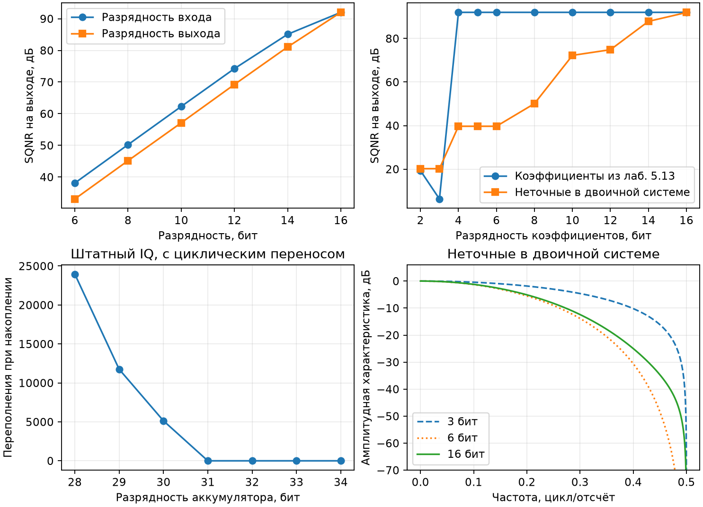

# Лабораторная 4.5 — Выбор разрядности FIR

[English version](../../en/labs/lab-4-5-fir-word-lengths.md) · [Второй этап задачи #94](https://github.com/Lay007/zynq-sdr-course/issues/94)

На причинном четырёхотводном IQ-фильтре из [лабораторной 5.13](lab-5-13-fir-architectures.md) выясните, какие разрядности определяют точность, а какие защищают от переполнения. В [лабораторной 4.1](lab-4-1-fixed-point-fir.md) квантование коэффициентов рассматривается на более длинном фильтре.

## Постановка эксперимента

Эталон выполняет свёртку I и Q независимо в float64. Модель начинает с нулевой истории и меняет только одну разрядность за прогон. В базовой конфигурации вход, коэффициенты и выход имеют знаковый формат Q1.15, аккумулятор имеет 34 разряда, из них 30 дробных. При разрядностях входа Bx и коэффициента Bh у произведения Bx + Bh − 2 дробных разрядов. При изменении ширины аккумулятора дробных разрядов остаётся 30, меняется только знаковый диапазон.

Вход и коэффициенты округляются к ближайшему, на половине шага к положительной бесконечности, затем ограничиваются знаковым диапазоном. Отводы обрабатываются от нового отсчёта к старому. После каждого умножения со сложением применяется выбранное правило переполнения аккумулятора. Модель сравнивает циклический перенос в дополнительном коде (wrap) и насыщение. Выход округляется и ограничивается один раз. Счётчики аккумулятора и выхода учитывают разные события. Ошибочное значение после wrap может попасть внутрь выходного диапазона.

Штатный вход содержит 8192 комплексных отсчёта при 2,4 Мотсч/с, тоны 120 и 620 кГц и аддитивный шум I/Q с заданным seed. Пиковый модуль равен 0,80 от полной шкалы. Первые три переходных отсчёта исключены из расчёта ошибки. SQNR считается как отношение RMS эталона к RMS полной ошибки на выходе в дБ. При переполнении ошибка включает детерминированные искажения. Характеристика по коэффициентам считается по сетке из 4096 точек. Для сравнения используются диапазоны 0–0,10 цикла/отсчёт для полосы пропускания и 0,35–0,50 для полосы подавления.

## Запуск

Из корня репозитория в Python-окружении курса:

```bash
python blocks/block_04_simulink_and_fixed_point/python/lab_4_5_fir_word_lengths.py --output build/lab45
python -m pytest tests/test_fir_word_lengths.py -q
```

Первая команда сохраняет график и JSON с параметрами, единицами и всеми результатами. Тест сравнивает базовую модель с векторами лабораторной 5.13 и проверяет знаковое округление и предельное значение аккумулятора.



[Полные метрики в JSON](../../assets/lab45_fir_word_lengths.json)

## Как читать результаты

| Изменение одного параметра | Наблюдение в модели |
| --- | --- |
| Вход с 8 до 16 бит | При остальных базовых параметрах SQNR растёт с 50,23 до 92,01 дБ. |
| Выход с 8 до 16 бит | При тех же условиях SQNR растёт с 45,17 до 92,01 дБ. |
| Коэффициенты с 3 до 4 бит | Для коэффициентов из 5.13 усиление на постоянном токе снижается с 1,5 до заданной единицы. Четырёх бит хватает, чтобы точно представить эти коэффициенты. |
| Коэффициенты, неточные в двоичном представлении | Для 0,113, 0,387, 0,387, 0,113 SQNR равен 39,69 дБ при 6 битах и 91,94 дБ при 16. Смотрите также частотную характеристику. Более грубое округление может усилить подавление на отдельных частотах, одновременно изменив фильтр в целом. |
| Аккумулятор с 30 до 31 бита | На штатном сигнале число операций MAC с переполнением снизилось с 5129 до нуля. Коды исходных коэффициентов положительные и в сумме дают 32768, поэтому 31 знаковый разряд также покрывает аналитическую границу для этих фиксированных коэффициентов. |

В стрессовом случае одна IQ-пара повторяется 64 раза, а все четыре коэффициента равны −1. Положительная сумма I достигает 2³². При 33 битах 61 операция MAC переполняется. Wrap даёт неверный знак на соответствующих выходах I. При 34 битах переполнений нет, но выход всё равно насыщается на 127 отдельных компонентах I/Q, поскольку модуль усиления стрессового фильтра на постоянном токе равен 4. Счётчик насыщений регистрирует ограничение диапазона и сам по себе не подтверждает корректность.

В реализации меньшая ширина входа и коэффициентов может уменьшить размер умножителя, а узкий аккумулятор сокращает разрядность регистра и сумматора. Выбор числа DSP48E1 зависит от синтеза и целевой FPGA. Численная модель даёт варианты для следующего прогона инструментов, а результаты маршрутизации и ресурсы исходной конфигурации приведены в лабораторной 5.13.

## Что включить в отчёт

Укажите разрядности, коэффициенты, амплитуду, seed, ошибку и счётчики переполнений и насыщений. Задайте минимальный SQNR и предложите наименьшие проверенные разрядности, которые удовлетворяют ему по отдельности. Затем проверьте совместный эффект через `--widths`. Порядок аргументов: вход, коэффициенты, аккумулятор, выход.

```bash
python blocks/block_04_simulink_and_fixed_point/python/lab_4_5_fir_word_lengths.py --widths 12 4 15 12 --output build/lab45-combined
```

Этот пример даёт 67,95 дБ без переполнений аккумулятора на штатном сигнале. Дополнительный результат записан в `combined_nominal` в JSON. Укажите, на какой диапазон входа и набор коэффициентов распространяется расчёт границы аккумулятора.
