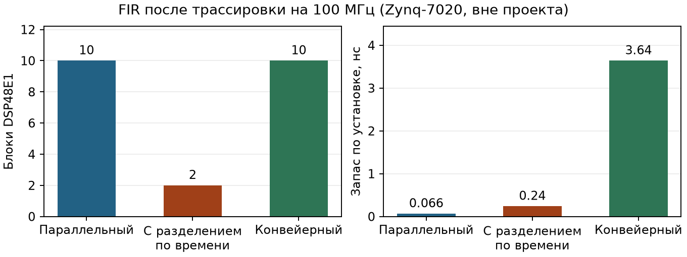

# Лабораторная 5.13 — Сравнение архитектур FIR

[English version](../../en/labs/lab-5-13-fir-architectures.md) · [Первый этап задачи #94](https://github.com/Lay007/zynq-sdr-course/issues/94)

Сравните три способа вычисления четырёхотводного IQ-фильтра из [лабораторной 5.2](lab-5-2-fir-rtl-mapping.md). После [лабораторной 5.5](lab-5-5-float-fixed-rtl-comparison.md) этот эксперимент поможет выбрать архитектуру под частоту отсчётов и бюджет DSP.

В [лабораторной 4.5](lab-4-5-fir-word-lengths.md) разрядность меняется независимо от расписания RTL.

## Общая арифметика и интерфейс

Для I и Q независимо вычислите `acc[n] = sum(h[k] * x[n-k], k=0..3)` и выдайте `clip((acc + 16384) >> 15, -32768, 32767)` с арифметическим сдвигом. Начальное состояние нулевое, линия задержки сдвигается только при приёме IQ-пары. Вход, коэффициенты и выход имеют знаковый формат Q1.15. У произведений 30 дробных разрядов. Сумма четырёх произведений может достигать `+2**32`, поэтому аккумулятор содержит 34 знаковых разряда. При округлении половина LSB уходит к положительной бесконечности.

Модуль работает по положительному фронту одного тактового сигнала. Сброс синхронный и активен высоким уровнем. Условие приёма входа `in_valid && in_ready`. Удерживайте отсчёт до появления ready. Приёмник забирает каждый результат с `out_valid` на положительном фронте. Обратного давления на выходе и переходов между тактовыми доменами нет. Четыре коэффициента держите постоянными в ходе работы, меняйте их только при сбросе. Сброс обнуляет историю и отбрасывает результаты в обработке. Коэффициенты лабораторной 5.2 `[4096, 12288, 12288, 4096]` используются в первом тесте. Порты коэффициентов оставляют умножители переменными при синтезе и позволяют сравнить расписания без оптимизации под заданные константы.

| Вариант | Расписание | Задержка (такты) | Интервал запуска (такты) | Предел по расписанию при 100 МГц (Мотсч/с) |
| --- | --- | ---: | ---: | ---: |
| Параллельный | Все произведения I/Q, дерево сумм и округление до регистра выхода | 1 | 1 | 100 |
| Folded | После приёма четыре такта работает один переиспользуемый MAC на канал | 5 | 5 | 20 |
| Конвейерный | Регистры после произведений, парных сумм и на выходе | 3 | 1 | 100 |

Задержка считается от фронта приёма входа до фронта, на котором следующий регистр может принять выход. Последний столбец даёт `f_clk / II` при непрерывном входе и готовом приёмнике. Достижимость этой тактовой частоты оценивается по отчёту тайминга.

## Запуск сравнения

Из корня репозитория запустите тест с Python 3.12+ и Icarus Verilog (`iverilog` и `vvp` в PATH). Для симуляции плата и инструменты производителя не требуются.

```bash
python tools/run_fir_architectures.py --artifacts-dir build/fir-architectures-sim
```

Ожидается 474 точных совпадения на вариант, каждое по I и Q. Тест проверяет знаковые границы, округление половины LSB, несимметричный импульсный отклик, насыщение, детерминированные случайные отсчёты, паузы на входе, непрерывную подачу и сброс во время обработки. Сверьте задержку и минимальный интервал запуска по логам симуляции.

Для сравнения после трассировки установите Vivado и добавьте `vivado` в PATH. В Windows PowerShell используйте `vivado.bat` или полный путь до него. Запускайте пакетный режим из отдельного каталога, чтобы временные файлы Vivado остались в нём.

```bash
mkdir -p build/fir-architectures-routed
cd build/fir-architectures-routed
vivado -mode batch -source ../../tools/vivado_fir_architectures.tcl -tclargs reports
cd ../..
```

Из корня репозитория соберите результаты симуляции и реализации.

```bash
python tools/summarize_fir_architectures.py build/fir-architectures-routed/reports build/fir-architectures-sim build/fir-architectures-summary
```

Скрипт выполняет `synth_design`, `opt_design`, `place_design` и `route_design` с настройками по умолчанию для каждого режима общего модуля. Tcl задаёт FPGA `xc7z020clg400-2`, а XDC задаёт период 10 нс и нулевые минимальные и максимальные внешние задержки I/O. Они описывают абстрактную границу OOC-модуля. Для выводов о тайминге на плате нужны тактовая сеть и ограничения интегрированного проекта. При сборе итогов проверяется полнота трассировки и покрытие портов и регистров ограничениями.

## Результаты сравнения

--8<-- "reports/fpga/fir-architectures-table.md"

Vivado 2020.1 полностью трассировал все три варианта. Folded использовал 2 блока DSP48E1 вместо 10, но потребовал больше LUT и триггеров для мультиплексоров, управления и аккумуляторов. У конвейерного варианта наибольший запас setup при приёме одного отсчёта за такт. В параллельном варианте худший путь setup шёл от умножителя до регистра выхода, а в конвейерном начинался от регистра парной суммы.

У всех вариантов есть нарушения hold на путях от входных портов к регистрам в OOC-модели с нулевыми задержками. Худший путь начинался от сброса у параллельного варианта и от входа I у двух других. Нарушений setup при 100 МГц нет. Hold при этих ограничениях не закрыт.



В [JSON с метриками](../../assets/lab513_fir_architectures.json) указаны хеши исходников, версия инструмента и результаты трассировки. Это результаты Vivado out-of-context для одной целевой частоты. Для оценки Fmax нужен прогон на нескольких периодах с новой трассировкой, а для выводов о RF нужны отдельные измерения.

## Что включить в отчёт

Возьмите шаблон `templates/fir-architectures-report.template.md` из репозитория. Укажите коэффициенты, версию симулятора, количество точных совпадений, задержку и интервал запуска. Для Vivado запишите версию, FPGA, XDC, число DSP48E1/LUT/FF/BRAM и запас setup и hold. Обоснуйте выбор архитектуры под заданную частоту отсчётов и бюджет ресурсов. Если выбранная тактовая частота зависит от ограничения, по которому тайминг не закрыт, укажите это явно.

Почему folded может занимать меньше DSP и больше LUT? Какой регистр изменил критический путь? Почему положительного setup slack недостаточно для закрытия тайминга? Различайте задержку и интервал запуска. Перед сравнением с округлением к ближайшему чётному проверьте обе половины LSB.
