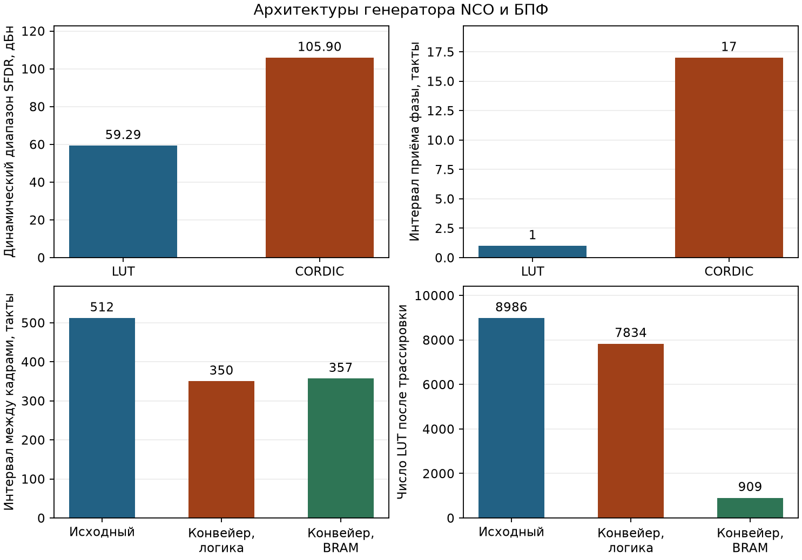

# Лабораторная 5.14 — Архитектуры NCO и БПФ

[English version](../../en/labs/lab-5-14-nco-fft-architectures.md) · [Третий этап задачи #94](https://github.com/Lay007/zynq-sdr-course/issues/94)

Сравните два преобразователя фазы в I/Q и три расписания одного 64-точечного БПФ. Цифровой генератор и смеситель описаны в [лабораторной 5.3](lab-5-3-nco-mixer-rtl.md), а приёмник с этим БПФ в [лабораторной 8.14](lab-8-14-ofdm-rtl-chain.md).

## Сравнение преобразователей NCO

На вход обоих вариантов поступает 32-битная фаза по модулю одного оборота. На выходе получаются косинус и синус в знаковом Q1.15 с амплитудой 7/8 от полной шкалы. Тестовые фазы задаёт общий внешний аккумулятор. Вариант NCO на LUT берёт десять старших битов фазы и хранит 257 значений на четверть периода. Итерационный CORDIC выполняет 16 шагов со сдвигом и сложением, приводит угол к нужному квадранту и компенсирует усиление начальным вектором. Оба варианта имеют синхронный сброс высоким уровнем, принимают фазу при `phase_valid && phase_ready` и выдают каждый действительный результат готовому приёмнику.

Тест проверяет 4108 кодов фазы на вариант по целочисленному эталону. Двенадцать случаев находятся на границах квадрантов или рядом с ними. Проверяются готовность, действительность, сброс во время вычисления и задержка от приёма входа до приёма выхода.

Для спектра используются 4096 выходных отсчётов когерентного комплексного тона в частотном отсчёте 197 с заданной начальной фазой. SFDR считается как `20 log10(амплитуда тона / амплитуда максимальной побочной составляющей)` в двустороннем спектре с прямоугольным окном. Ошибка фазы измеряется относительно идеального комплексного вектора на всех 4108 кодах. SFDR зависит от кода приращения и усечения фазы. Перед обобщением повторите расчёт для другого когерентного тона.

| Преобразователь | Задержка и интервал приёма (такты) | Макс. ошибка фазы (градусы) | SFDR (дБн), тон 197 |
| --- | ---: | ---: | ---: |
| LUT на четверть периода | 1 | 0,3517 | 59,29 |
| Итерационный CORDIC | 17 | 0,00277 | 105,90 |

При одной тактовой частоте NCO на LUT принимает фазу каждый такт, CORDIC раз в 17 тактов. Для одинаковой частоты отсчётов CORDIC потребуется более высокая тактовая частота или больше параллелизма. Аккумулятор фазы находится вне обоих трассированных блоков.

Для тона в частотном отсчёте 256 приращение фазы равно ровно 64 шагам адреса LUT. Отбрасываемая дробная часть фазы остаётся постоянной на всём тоне. В этом прогоне SFDR составил 101,27 дБн для NCO на LUT и 99,18 дБн для CORDIC. По одному коду приращения нельзя определить наихудший SFDR.

## Сравнение расписаний БПФ

Все варианты выполняют `FFT(x)/64` в знаковом Q1.15. Тот же тракт приёмника использует нормированное обратное преобразование и комплексное сопряжение. На каждой из шести стадий radix-2 результат делится на два с fixed-point округлением. Однотактная и конвейерная бабочки используют одну арифметику. Конвейерный вариант хранит рабочие точки в логике либо в двух банках BRAM. Точки каждой пары radix-2 отличаются одним битом адреса и попадают в разные банки по чётности адреса.

На вход подаются два кадра по 64 IQ-отсчёта подряд. Измеряются такты от приёма первого входа до приёма первого выхода и интервал между началами кадров. Отдельный тест с паузами на входе и остановками выхода проверяет порядок отсчётов, их стабильность и границы кадров. Каждый прогон сверяет 128 комплексных выходов с фиксированным эталоном и требует нулевого насыщения. Максимальная ошибка одной компоненты относительно NumPy на тестовом кадре не превышает 1,754 LSB.

| Расписание | Вычисление (такты) | От первого входа до первого выхода (такты) | Интервал между кадрами (такты) |
| --- | ---: | ---: | ---: |
| Однотактная бабочка, память в логике | 384 | 448 | 512 |
| Конвейерная бабочка, память в логике | 222 | 286 | 350 |
| Конвейерная бабочка, память в BRAM | 229 | 293 | 357 |

Ядро обрабатывает один кадр за раз. Интервал включает загрузку и выдачу. При непрерывном обмене предел расписания равен `64 × f_clk / frame_ii` комплексных отсчётов в секунду. Перед выбором тактовой частоты проверьте ограничения тайминга. Семь дополнительных тактов варианта BRAM связаны с регистрируемым чтением памяти.

## Воспроизведение

Из корня репозитория запустите Python с NumPy и Icarus Verilog в PATH. Первая команда генерирует значения для ROM блока NCO на LUT, проверяет два варианта NCO и три расписания БПФ. Вторая сверяет арифметику нормированного БПФ с независимыми вычислениями NumPy.

```bash
python tools/run_dsp_architectures.py
python -m pytest tests/test_ofdm_fft_fixed.py -q
python tools/run_dsp_architectures.py --family nco --tone-bin 256 --output build/dsp-nco-bin256
```

Для прогона Vivado добавьте `vivado` в PATH. В Windows используйте `vivado.bat` или полный путь. Запускайте каждое семейство из отдельного рабочего каталога.

```bash
mkdir -p build/dsp-nco-ooc build/dsp-fft-final
cp build/dsp-architecture-sim/nco_quarter_q15.mem build/dsp-nco-ooc/
cd build/dsp-nco-ooc
vivado -mode batch -source ../../tools/vivado_dsp_architectures.tcl -tclargs nco reports
cd ../dsp-fft-final
vivado -mode batch -source ../../tools/vivado_dsp_architectures.tcl -tclargs fft reports
cd ../..
```

Из корня репозитория соберите результаты симуляции и реализации.

```bash
python tools/summarize_dsp_architectures.py build/dsp-architecture-sim build/dsp-nco-ooc/reports build/dsp-fft-final/reports build/dsp-summary
```

Используются RTL курса и память с умножителями, которые Vivado определяет при синтезе. Для всех режимов заданы `xc7z020clg400-2`, период 10 нс и нулевые внешние задержки I/O. Отдельно лицензируемых ядер БПФ или CORDIC в эксперименте нет. Тактовый сигнал и задержки моделируют абстрактную границу модуля при трассировке вне проекта.

## Результаты трассировки

--8<-- "reports/fpga/dsp-architectures-table_ru.md"



[Метрики, результаты и хеши исходников](../../assets/lab514_dsp_architectures.json)

В отчёте укажите, сколько фаз в секунду нужно генератору, допустим ли побочный тон при выбранном приращении и сколько кадров БПФ примет интерфейс в секунду. Приведите DSP48E1, LUT, FF, BRAM, запас по установке и удержанию. Пропускная способность в симуляции сама по себе не подтверждает работу на заданной тактовой частоте. Тайминг системы на плате и измерения RF требуют отдельных проверок.
