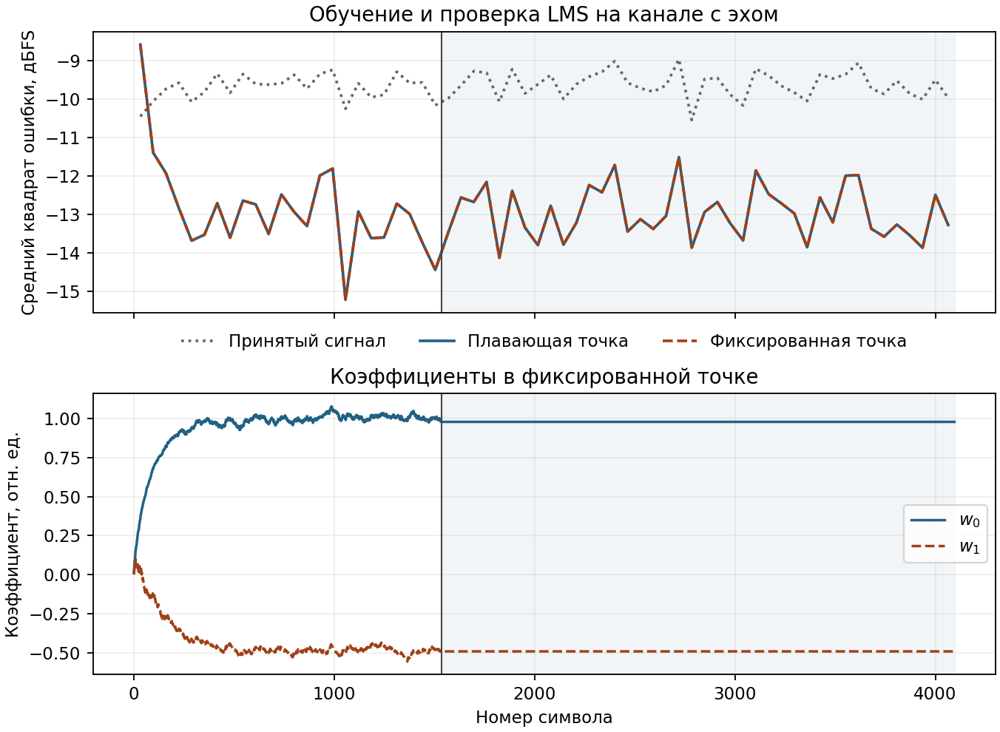

# Лабораторная 5.15 — Двухотводный LMS-эквалайзер

[English version](../../en/labs/lab-5-15-lms-equalizer.md) · [Четвёртый этап задачи #94](https://github.com/Lay007/zynq-sdr-course/issues/94)

Обучите двухотводный эквалайзер методом наименьших средних квадратов (LMS) по известной BPSK-последовательности. Зафиксируйте коэффициенты и проверьте, как эквалайзер обрабатывает следующие символы. Модель использует один вещественный отсчёт на символ и предполагает известные границы символов. Фильтры с постоянными коэффициентами рассматриваются в [лабораторной 5.13](lab-5-13-fir-architectures.md).

## Модель и арифметика с фиксированной точкой

Сгенерируйте 4096 равновероятных BPSK-символов `d[n]` с амплитудами ±0,5 полной шкалы. Используйте генератор NumPy с начальным значением 9415. Сформируйте `x[n] = 0.8 d[n] + 0.62 d[n−1] + noise[n]` с нулевой начальной историей и гауссовым шумом со стандартным отклонением 0,045 полной шкалы. Для каждого символа вычислите оценку `y = w₀ x[n] + w₁ x[n−1]` и ошибку `e = d[n] − y`. Задайте нулевые начальные коэффициенты и прибавляйте к каждому `e x / 16`, используя отсчёт его отвода. Обновляйте коэффициенты на первых 1536 символах и зафиксируйте их на оставшихся 2560.

Целочисленная модель и RTL используют знаковый формат Q1.15 для отсчётов и эталона, Q2.14 для коэффициентов и 33 бита для суммы произведений. Округлите оценку до знакового 19-битного числа с 15 дробными разрядами. Ошибка в петле обратной связи имеет тот же формат. Произведения ошибки на входные отсчёты имеют 30 дробных разрядов. Сдвиг вправо на 20 разрядов применяет шаг обучения и переводит приращение в Q2.14. Оба сдвига округляют до ближайшего значения, при равенстве расстояний выбирается большее. После сложения коэффициенты насыщаются на границах знакового 16-битного диапазона. Общий флаг отмечает насыщение любого из двух коэффициентов.

На фронте такта с высоким `in_valid` модуль записывает оценку и обновляет историю отсчётов. Если `train` тоже высокий, на том же фронте записываются новые коэффициенты. Оценка вычисляется по коэффициентам, действовавшим до этого фронта. Следующий регистр считывает `out_valid` и результат на следующем фронте. Синхронный сброс активен высоким уровнем, обнуляет состояние и снимает `out_valid`. В симуляции вход принимает отсчёт на каждом такте. Потребитель должен считывать все действительные результаты.

## Запуск и проверка

Из корня репозитория запустите Python с NumPy и Matplotlib. Для проверки RTL добавьте Icarus Verilog в PATH.

```bash
python tools/run_lms_equalizer.py --rtl
```

Без `--rtl` запускается численный эксперимент. Скрипт по умолчанию сохраняет обе языковые версии графика и JSON с метриками в `build/lms-sim/`. В режиме RTL он также сохраняет входные векторы и журнал симуляции. Тест проверяет `out_valid`, оценку, оба коэффициента и флаг насыщения на всех 5257 тактах, включая 5122 принятых отсчёта. В проверку входят паузы на входе, приоритет сброса, фиксация коэффициентов при заведомо неверных эталонах, насыщение на обеих границах и максимальная положительная сумма произведений при предельных знаковых входных данных. Каждая из двух последовательностей для проверки насыщения даёт 158 срабатываний флага.

## Проверка с фиксированными коэффициентами

Рассчитайте средний квадрат отклонения от переданных амплитуд без дополнительной подстройки усиления принятого сигнала. Определяйте биты по знаку и считайте ошибки на одних и тех же 2560 символах.

| Сигнал | Средний квадрат ошибки (доля полной шкалы в квадрате) | Битовые ошибки | BER в этом прогоне |
| --- | ---: | ---: | ---: |
| Принятый | 0,109634 | 24 | 0,9375% |
| После эквалайзера с плавающей точкой | 0,051210 | 2 | 0,078125% |
| После эквалайзера с фиксированной точкой | 0,051212 | 2 | 0,078125% |

Коэффициенты модели с фиксированной точкой установились примерно на `[0.978210, −0.492432]`. В опыте с BPSK входные коды и коэффициенты не вышли за пределы своих диапазонов. График показывает средний квадрат ошибки по блокам из 64 символов и коэффициенты в фиксированной точке. Заливка отмечает участок проверки. BER рассчитана по одной реализации последовательности и шума.



## Временной анализ после трассировки

При наличии Vivado запустите реализацию для `xc7z020clg400-2` с периодом 10 нс и нулевыми внешними задержками ввода и вывода. В Windows используйте `vivado.bat` или полный путь к нему.

```bash
mkdir -p build/lms-ooc-final
cd build/lms-ooc-final
vivado -mode batch -source ../../tools/vivado_lms_equalizer.tcl -tclargs reports
cd ../..
python tools/run_lms_equalizer.py --rtl --reports build/lms-ooc-final/reports --output build/lms-evidence
```

Vivado 2020.1 завершил трассировку изолированного модуля. Использовано 4 блока DSP48E1, 161 LUT и 69 триггеров, BRAM не потребовалась. При заданном периоде запас по установке (WNS) составил −6,750 нс, по удержанию (WHS) −0,266 нс. Худший путь по установке проходит через петлю обновления коэффициентов, а худший по удержанию начинается на входе сброса при условных ограничениях ввода и вывода. Дополнительный регистр в петле задержит момент, когда последующие символы увидят обновлённые коэффициенты. Это потребует соответствующего изменения эталонной модели или расписания входных отсчётов. Версия инструмента и хеши исходников записаны в [JSON с метриками](../../assets/lab515_lms_equalizer.json). Проверка охватывает синтетические данные, симуляцию RTL и трассировку изолированного модуля. Измерений на плате и в радиотракте не проводилось.

## Разбор результата

Рассчитайте BER на участке с фиксированными коэффициентами. Если включить участок обучения, в расчёт попадут выходы при двух разных режимах обновления. Если обновлять коэффициенты на проверочном участке, эталонные символы будут влиять на результат проверки.

1. Какие отсчёты получаются при свёртке двух фиксированных коэффициентов с двумя коэффициентами канала? Как по ним объяснить остаточную ошибку?
2. Почему при фиксированных коэффициентах историю входных отсчётов нужно обновлять?
3. Как подавать отсчёты, если расчёт в петле занимает два такта и каждый символ по-прежнему должен использовать коэффициенты, обновлённые предыдущим символом?
