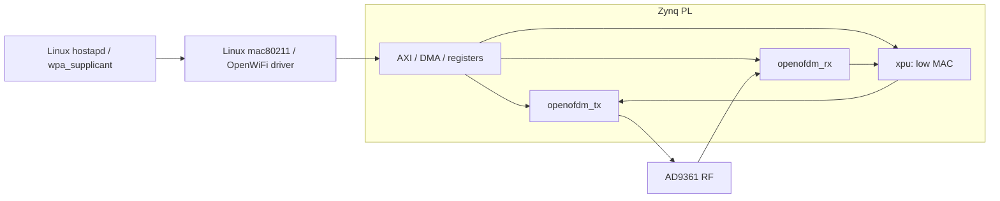

# Инженерный трек OpenWiFi: PHY/MAC на Zynq

> **Статус: планируемая дополнительная специализация (12.11.2026).** На наших физических платах ZynqSDR пока **не подтверждены** загрузка OpenWiFi, работа FPGA/MAC, Wi-Fi-соединение, измерения RF или сбор CSI.

[English version](../en/openwifi-engineering-track.md) | [Issue #92](https://github.com/Lay007/zynq-sdr-course/issues/92) | [ADR 0005](../adr/0005-openwifi-engineering-track.md)

## Зачем это нужно

Основной курс из 12 блоков уже построен по маршруту **эталонная модель -> fixed-point -> RTL/testbench -> FPGA -> радиотракт -> измерения**. OpenWiFi даёт продвинутое практическое продолжение QPSK/OFDM: реальные пакеты IEEE 802.11, аппаратный MAC, Linux-драйвер и сетевой обмен.

Проект [OpenWiFi](https://github.com/open-sdr/openwifi) реализует совместимый с Linux `mac80211` стек Wi-Fi на SDR, а [openwifi-hw](https://github.com/open-sdr/openwifi-hw) содержит реализацию FPGA. Доступная открытая конфигурация включает OFDM в **802.11a/g**, ограниченный режим **802.11n (20 МГц, один пространственный поток)**. Поддержка **802.11b** отсутствует; полный набор возможностей 802.11n и Wi-Fi 6 для открытого варианта не предполагается.

В upstream есть примеры Zynq-7020 с AD936x, но они **не доказывают**, что готовая прошивка подходит нашей **FISH Ball PlutoSDR Rev.A / Zynq-7020 + AD9361**. Совместимость нужно подтвердить по схеме платы, тактированию, boot flow, интерфейсу AD9361, Linux и FPGA.

## Архитектура для изучения

Это **концептуальная**, а не точная схема интеграции нашей платы. Процессор ARM/Linux обеспечивает управление стеком Wi-Fi, FPGA обрабатывает критичные по времени функции PHY и нижнего MAC (доступ к среде, ACK и тайминги). Реальные границы clock-domain, DMA и прерываний требуют проверки по зафиксированной версии upstream.

## Учебные единицы (пока не зарегистрированные лабораторные)

| Единица | Связь с курсом | Результат и критерий проверки |
| --- | --- | --- |
| **WIFI-1. OFDM PHY** | Блок 8, Lab 8.5/8.10 | Детерминированная модель 802.11a/g на MATLAB/Python: FFT 64 точки, пилоты, защитный интервал, BPSK/QPSK/QAM, PAPR/EVM; сравнение с независимыми тестовыми векторами. |
| **WIFI-2. Пакетный приёмник** | Блоки 7–9 | Детектор преамбулы, синхронизация, coarse/fine CFO, оценка канала, эквализация, демаппинг, деинтерливинг, Витерби, дескремблирование, FCS/CRC; успешное декодирование контрольного пакета и негативные тесты. |
| **WIFI-3. Fixed-point и RTL** | Блоки 4–5 | Изучение/симуляция `openofdm_tx` и `openofdm_rx`, контроль разрядности, масштабирования, задержек, timing и ресурсов. Численное сравнение с эталонной моделью. |
| **WIFI-4. Портирование на ZynqSDR** | Блоки 5–7, 11 | Инвентаризация, матрица совместимости, отдельный экспериментальный boot profile, подтверждённая инициализация AD9361 и интерфейса `sdr0`. |
| **WIFI-5. PHY/MAC в реальном канале** | Блоки 7, 11 | Подключение AP/STA, Wireshark/iperf3, PER, throughput, повторы MAC и задержка в зависимости от MCS и ослабления. PHY rate, MAC и IP throughput не смешивать. |
| **WIFI-6. CSI и sensing** | Блоки 9, 12 | Запись timestamp, частотной характеристики канала, CFO и результатов эквалайзера; сравнение неподвижной/движущейся сцены и оценка неопределённости. |

Обозначения `WIFI-1` ... `WIFI-6` специально не занимают существующие номера лабораторных. При реализации каждая работа должна получить RU/EN-страницы, скрипты, отчёт и подходящий тест CI.

## План и контрольные точки

1. **Техническая осуществимость без изменения плат.** Зафиксировать commit/tag всех трёх upstream-репозиториев: `openwifi`, `openwifi-hw`, `openwifi-hw-img`. Сравнить платы-образцы с нашими: AD9361, clocks/resets, PS MIO, DDR, адреса AXI, DMA, IRQ, Device Tree, ядро/драйвер, U-Boot. Уточнить Vivado/Vitis, лицензии IP (включая Xilinx Viterbi Decoder) и условия работы evaluation-лицензии.
2. **Software-only PHY.** Создать модель передачи/приёма пакетов IEEE 802.11a/g с воспроизводимыми IQ-векторами и метаданными, отдельными тестами CFO, EVM, ошибок синхронизации, кодирования и FCS. Не объявлять модельные результаты реальными измерениями.
3. **RTL-верификация.** Сопоставить алгоритмы и fixed-point с `openofdm_tx/rx`, использовать доступные тестбенчи и честно фиксировать ограничения инструментов/IP. Обычные CI-проверки курса не должны требовать Vivado или плату.
4. **Изолированное портирование.** Следовать [ADR о профилях прошивки](../adr/0004-zynqsdr-firmware-profiles.md). Статус `openwifi-experimental` является **предложением**, не подтверждённым образом. Сначала нужны индивидуальные boot-инвентаризация и **проверенный** путь восстановления для каждой платы. В [аппаратном наборе](https://github.com/Lay007/zynq-sdr-course/blob/main/hardware/7020_ad936x_sdr/README.md) уже зафиксированы случаи timeout калибровки AD9361 после замены PL: факт загрузки bitstream недостаточен.
5. **Измерения RF/MAC.** Начать с RX-only и кабельного стенда с рассчитанным ослаблением; затем ассоциация клиента с AP, IP-обмен, `iperf3`, Wireshark. Фиксировать частоту, полосу, уровни, ослабление, hashes и версию ПО. Соблюдать [RF safety](../rf-safety.md) и местные правила использования спектра. Прямое соединение TX/RX без проверки энергетического бюджета запрещено.
6. **Дополнительный CSI-эксперимент.** Использовать [CSI](https://github.com/open-sdr/openwifi/blob/master/doc/app_notes/csi.md) и [self-CSI sensing](https://github.com/open-sdr/openwifi/blob/master/doc/app_notes/radar-self-csi.md) как технические ориентиры, а не как доказательство работоспособности на нашей плате. Привязывать CSI к timestamp пакетов. Полоса 20 МГц сама по себе не гарантирует высокоточного измерения задержек/координат.

## Требования к экспериментальному отчёту

Для каждого **реального** опыта записывать: board A/B, SHA-256 boot/RTL-файлов, версии ядра и драйвера, версию upstream, boot mode, AP/STA/monitor, частоту (Гц), полосу (Гц), частоту дискретизации (отсчётов/с), gain (дБ), внешнее ослабление (дБ), путь сигнала, MCS, число пакетов, timestamps и команды анализа.

Отдельно приводить **BER** (битовые ошибки), **PER** (ошибки пакетов), **EVM**, **CFO**, число повторов MAC, **throughput в Мбит/с**, **задержку в мс** и уровень, на котором они измерены. Не переносить цифры производительности upstream на нашу плату без испытаний.

- **Software-gate:** тестовые пакеты декодируются; негативные сценарии обнаруживаются.
- **RTL-gate:** зафиксированы версии RTL/инструментов, численные ошибки, timing/resource reports и PASS тестбенчей.
- **Board-gate:** реальные boot-логи, калибровка AD9361, `sdr0`, частоты тактирования и проверенное восстановление.
- **RF-gate:** реальная ассоциация и обмен, packet capture, повторяемые метрики и безопасный радиотракт.
- **CSI-gate:** связь CSI с конкретными пакетами, статический эталон, повторные измерения и неопределённость.

## Границы репозиториев и лицензий

В открытом `zynq-sdr-course` храним **собственные** модели, описание экспериментов, скрипты и небольшие проверяемые результаты. Образы загрузки, дампы QSPI, закрытые IP и тяжёлые IQ-архивы размещаем отдельно по [ADR 0003](../adr/0003-binary-artifact-repository-boundary.md). Не копируем код OpenWiFi, распространяемый на условиях AGPL-3.0-or-later, в репозиторий курса с MIT без отдельного анализа совместимости лицензий. Для исследований используем ссылки на конкретные upstream-версии.

## Ссылки

- [OpenWiFi (Linux, драйвер, функции)](https://github.com/open-sdr/openwifi)
- [openwifi-hw (FPGA/RTL)](https://github.com/open-sdr/openwifi-hw)
- [openwifi-hw-img (собранные аппаратные файлы)](https://github.com/open-sdr/openwifi-hw-img)
- [Замечания upstream об 802.11n](https://github.com/open-sdr/openwifi/blob/master/doc/app_notes/ieee80211n.md)
- [Задача внедрения #92](https://github.com/Lay007/zynq-sdr-course/issues/92)
