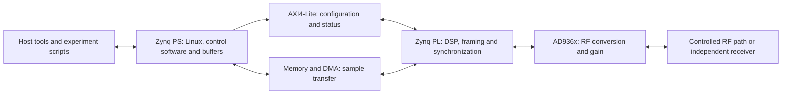
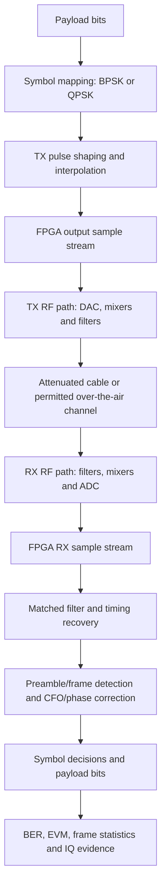
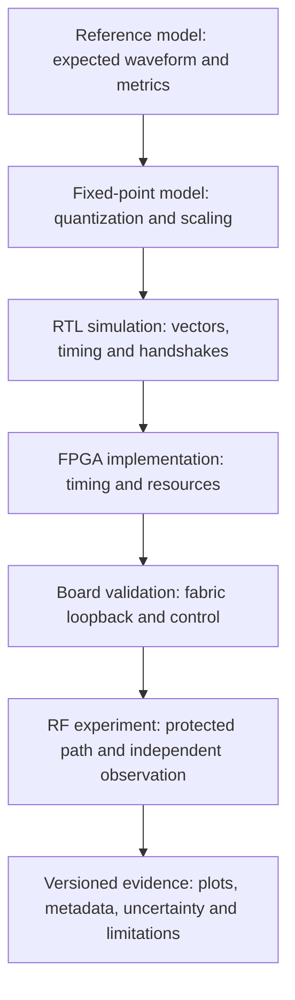

# Architecture: from DSP model to a measured SDR link

These diagrams are **conceptual**. They describe the engineering boundaries of the course, not a board-specific wiring diagram or proof that every path has been tested on hardware. See the [course architecture](https://github.com/Lay007/zynq-sdr-course/blob/main/docs/model-to-measurement.md) and [PS/PL explanation](https://github.com/Lay007/zynq-sdr-course/blob/main/docs/zynq-ps-pl-architecture.md) for the detailed discussion.

## 1. Zynq PS, PL and RF frontend

The PS/PL boundary carries **two different kinds of traffic**: control/status and streaming sample data. The precise DMA and AD936x interfaces depend on the hardware design and software image. A PS/PL mailbox is a useful first test before moving IQ data.

- [Zynq PS/PL architecture](https://github.com/Lay007/zynq-sdr-course/blob/main/docs/zynq-ps-pl-architecture.md)
- [PS/PL mailbox Vivado bring-up](https://github.com/Lay007/zynq-sdr-course/blob/main/docs/zynq-ps-pl-mailbox-vivado-bringup.md)
- [Hardware bring-up checklist](https://github.com/Lay007/zynq-sdr-course/blob/main/docs/hardware-bringup-checklist.md)

## 2. Transmit and receive signal chain

This is a simplified logical chain: a particular lab may apply CFO estimation or preamble synchronization in another order, and some stages are implemented only in software or simulation. Read the exact lab before treating this as an implementation block diagram.

- [DSP → FPGA bridge](https://github.com/Lay007/zynq-sdr-course/blob/main/docs/dsp-to-fpga.md)
- [Digital-link metric definitions](https://github.com/Lay007/zynq-sdr-course/blob/main/docs/digital-link-metrics.md)
- [Hardware evidence index](https://github.com/Lay007/zynq-sdr-course/blob/main/docs/hardware-evidence-index.md)

## 3. Validation is a ladder, not one PASS flag

Each stage answers a different question. A mismatch should be investigated at the **first stage where the observed behavior differs**. A simulation PASS does not mean that FPGA routing met timing; an FPGA fabric loopback does not establish RF performance.

For measured claims, open the [evidence index](https://github.com/Lay007/zynq-sdr-course/blob/main/docs/hardware-evidence-index.md) and follow its original reports. For safe experiments, read [RF safety](https://github.com/Lay007/zynq-sdr-course/blob/main/docs/rf-safety.md) first.

[Home](Home) · [DSP to FPGA](DSP-to-FPGA) · [Troubleshooting](Troubleshooting)
